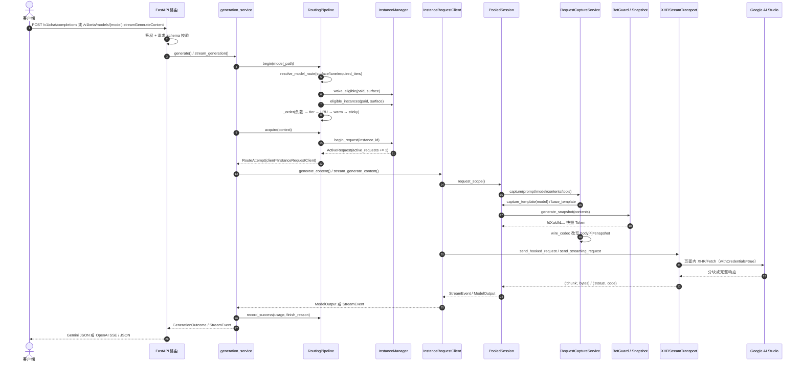

# aistudio-api 系统架构设计

本文档说明 `rebuild-upstream` 目标树的系统架构、实例模型、请求路由、单页生命周期、保活、日志与协议中立生成链。文档以当前 HEAD 代码为事实标准；出现分歧时以代码为准，并同步回本文档。所有实现引用均使用 `file:line`。

---

## 目录

- [1. 四层架构与依赖方向](#1-四层架构与依赖方向)
- [2. 实例模型、Tier 选择器与池容量](#2-实例模型tier-选择器与池容量)
- [3. 请求生命周期](#3-请求生命周期)
- [4. 路由、负载均衡与错误恢复](#4-路由负载均衡与错误恢复)
- [5. 单页生命周期与 D-05/D-10/D-11](#5-单页生命周期与-d-05d-10d-11)
- [6. 24h 保活、模型发现与动态 Paid](#6-24h-保活模型发现与动态-paid)
- [7. B4 日志三 Sink 与脱敏](#7-b4-日志三-sink-与脱敏)
- [8. 协议中立生成链与 ATG](#8-协议中立生成链与-atg)
- [9. 跨平台支持与依赖隔离](#9-跨平台支持与依赖隔离)

---

## 1. 四层架构与依赖方向

系统按四层组织：**API 接入层 → Application 应用层 → Domain 领域层 ← Infrastructure 基础设施层**。Domain 是纯数据与错误契约；Application 编排用例；Infrastructure 提供浏览器、CDP、Wire 编解码、账号存储与日志等适配器；API 只负责协议校验、鉴权与响应渲染。

```mermaid
flowchart TD
    Client["客户端<br/>Gemini SDK / OpenAI SDK / Web 控制台"]

    subgraph API["1. API 接入层 (api/)"]
        RoutesGemini["routes_gemini.py"]
        RoutesOpenAI["routes_openai.py"]
        RoutesModels["routes_models.py"]
        RoutesInstances["routes_instances.py"]
        RoutesAccounts["routes_accounts.py"]
        RoutesKeepalive["routes_keepalive.py"]
        RoutesLogs["routes_logs.py"]
        RoutesSystem["routes_system.py"]
        Deps["dependencies.py<br/>Web/API Key 鉴权"]
    end

    subgraph APP["2. Application 应用层 (application/)"]
        Generation["generation_service.py<br/>协议中立生成主链"]
        Routing["routing_pipeline.py<br/>候选排序 / 获取 / 重试 / 改绑"]
        Eligibility["routing_eligibility.py<br/>surface / lane / tier 准入"]
        Safety["routing_safety.py<br/>单请求切号预算"]
        Instances["instance_manager.py<br/>实例生命周期与 D-05 换绑"]
        Keepalive["account_keepalive.py<br/>24h Cookie / 元数据"]
        ChatSvc["chat_service.py<br/>请求规范化"]
        Signature["signature_cache.py<br/>PG-01 思维签名缓存"]
        ATG["atg/<br/>合成工具传输"]
        Formats["format_converters/<br/>OpenAI 请求/响应"]
    end

    subgraph DOMAIN["3. Domain 领域层 (domain/)"]
        DomainModels["models.py<br/>Candidate / ModelOutput / GeneratedImage"]
        DomainInstances["instances.py<br/>Instance / InstanceState"]
        DomainErrors["errors.py<br/>统一异常体系"]
    end

    subgraph INFRA["4. Infrastructure 基础设施层 (infrastructure/)"]
        Pool["gateway/instance_pool.py<br/>单页实例池"]
        Pooled["gateway/pooled_session.py<br/>池化会话"]
        Session["gateway/session.py<br/>控制面单页会话"]
        BotGuard["gateway/botguard_bootstrap.py<br/>WAA / 模板捕获"]
        Capture["gateway/capture.py<br/>模板内存改写"]
        Wire["gateway/wire_*.py<br/>JSPB 编解码"]
        Stream["gateway/stream_parser.py<br/>截断修复流解析"]
        Streaming["gateway/streaming.py<br/>流式终态与分发"]
        Transport["gateway/transport.py<br/>CDP Binding 流传输"]
        Discovery["gateway/model_discovery.py<br/>ListModels / Paid 真值"]
        Browser["browser/<br/>CDP / CloakBrowser / JS"]
        Account["account/<br/>Cookie / 账号存储"]
        Logs["utils/logger.py<br/>log_broadcast.py"]
    end

    Client --> API
    API --> APP
    APP --> DOMAIN
    INFRA --> DOMAIN
    APP -. "端口 / 适配器" .-> INFRA
    Pooled --> Browser
    Session --> Browser
    BotGuard --> Browser
```



**依赖约束**：

- API 层不直接访问浏览器、Cookie 或 Wire 数组；只通过依赖注入取得 `RoutingPipeline`、`AccountService`、`RuntimeState`（`api/dependencies.py:124-170`）。Gemini 协议渲染与错误映射留在 API 层（`api/gemini_service.py`、`api/error_mapping.py`）。
- Application 层**不导入 `aistudio_api.api` 或 FastAPI**（`tests/unit/test_layer_boundaries.py` 静态校验）；HTTP 请求 DTO 由 `application/contracts/` 提供，finish reason 映射在无框架依赖的 `application/finish_reasons.py`，统计记录通过构造注入的 `stats_recorder` 回调完成，不反向读取 `api.state.runtime_state`。
- Domain 不导入 FastAPI、CDP 或 JSPB；`Instance` 只暴露用户可见字段（`domain/instances.py:18-33`）；Tier/Paid 共享规则位于 `domain/model_access.py`。
- Infrastructure 负责 CDP、Cookie、模板、Wire、流解析与日志；它依赖 Domain 的错误/模型，**不反向依赖 application**（`tests/unit/test_layer_boundaries.py` 静态校验）。
- 历史 P0 债务（`application -> api` 的 6 文件反向依赖、`infrastructure -> application` 的 `model_access` 循环）已通过 B7-01/B7-02/B7-03 消除，并由 `tests/unit/test_layer_boundaries.py` 固化；不再保留临时豁免或 P0 断言。

### 1.1 关键模块职责

| 层 | 文件 | 职责 |
|---|---|---|
| API | `routes_gemini.py` | `/v1beta/models/{model}:generateContent`、`:streamGenerateContent`、`:countTokens` |
| API | `gemini_service.py` | Gemini 协议渲染、SSE 事件与协议错误载荷 |
| API | `error_mapping.py` | 四协议错误映射；Gemini 403/502/429 状态字符串与 JSPB 清理 |
| API | `routes_openai.py` | `/v1/chat/completions`、OpenAI 流式/非流式响应 |
| API | `routes_models.py` | OpenAI `/v1/models` 与 Gemini 模型发现 |
| API | `routes_instances.py` | 实例列表、创建、关闭、重启、surface 切换、改绑 |
| API | `routes_accounts.py` | Cookie 导入、多子账号探活、激活、预设 |
| API | `routes_keepalive.py` | 手动触发/查询 `auth_update`、`metadata_refresh`、`active_activity` |
| API | `routes_logs.py` | 日志 SSE、ring 查询、1/3/7 天导出 |
| API | `dependencies.py` | Web 密码会话、API Key 鉴权、运行时单例注入 |
| Application | `contracts/` | Gemini/OpenAI HTTP 请求 DTO（无 FastAPI 依赖） |
| Application | `finish_reasons.py` | wire finish code → Gemini `finishReason` |
| Application | `generation_service.py` | 路由获取、重试、ATG wrap/unwrap、usage/finish/response_id |
| Application | `routing_pipeline.py` | 模型准入、唤醒、候选排序、`active_requests` 句柄、失败槽改绑 |
| Application | `routing_eligibility.py` | surface/lane/required tier 解析与 Paid 准入 |
| Application | `routing_safety.py` | 单请求 `max_switches` 预算；无熔断/租约 |
| Application | `instance_manager.py` | 实例记录、启动、创建、关闭、`reassign`、D-05 `rebind_account` |
| Application | `account_keepalive.py` | 24h Cookie 回写、tier/email 刷新、可选控制页活动 |
| Application | `chat_service.py` | Gemini/OpenAI 请求归一、多模态、工具 Struct、`[toolshape]` |
| Application | `signature_cache.py` | 按 `call_id` 持久化真实 `thoughtSignature`，TTL 30 天 |
| Application | `format_converters/` | OpenAI 请求/响应/媒体转换 |
| Application | `atg/` | 合成工具包装、提取、修复、流式解包 |
| Domain | `model_access.py` | Tier 排序与 Paid/tier 共享判定 |
| Infrastructure | `instance_pool.py` | 单页实例、`active_requests`、有界 retire、Page→Context 关闭顺序 |
| Infrastructure | `pooled_session.py` | 池化会话的 Page/Cookie/模板/快照/传输 |
| Infrastructure | `session.py` | 控制面单页会话与有界 rebind（D-05/D-10/D-11） |
| Infrastructure | `botguard_bootstrap.py` | WAA 握手、Temporary Chat、真实模板捕获、输入清理 |
| Infrastructure | `model_discovery.py` | ListModels XHR/HTTP、字段解析、Paid 真值与快照 |
| Infrastructure | `wire_*.py` | JSPB 请求/响应/Wire 类型与索引常量 |
| Infrastructure | `stream_parser.py` | XSSI 去除、增量分块、截断 JSON 修复 |
| Infrastructure | `streaming.py` | finish/usage 终态、`CONTINUING=22`、工具流空闲 STOP |
| Infrastructure | `logger.py` / `log_broadcast.py` | 三 Sink、ring、SSE、脱敏、归档 |

---

## 2. 实例模型、Tier 选择器与池容量

### 2.1 1 实例 = 1 账号 + 1 Context + 1 Page + 1 surface

实例是不可再拆的调度与用量单位（`domain/instances.py:18-33`、`instance_pool.py:1-11`）：

- **1 个账号**：实例绑定一个 `AccountMeta`，同一账号的 chat/build 不并存。
- **1 个 BrowserContext**：实例在独立 `BrowserContext` 内运行，互不共享 Cookie/缓存/模板。
- **1 个 Page**：实例同一时刻只允许一个 active Page；切换时先关闭旧 Page 再创建新 Page。
- **1 个 surface**：`chat` 或 `build`；需要换面就显式关闭/切换，不静默换面。

`InstanceSlot` 持有 `context_id`、`tier`、`state`、`generation`、`active_requests` 与 `lifecycle_lock`（`instance_pool.py:138-214`）。`realm_id = "<slot_id>-g<generation>"` 用于 capture/streaming 缓存隔离（`instance_pool.py:171-174`）。

### 2.2 Free / Paid lane 隔离

- lane 由**账号 tier** 决定，不由模型名决定：`account_is_paid(tier)` 为真进入 paid lane，否则 Free lane（`domain/model_access.py:273-285`）。
- 同一账号的 chat/build 不并存；Free 实例与 paid 实例可同时在线，各自拥有独立 Context/Page/Cookie/模板/在途计数。
- Free 模型只能命中 Free 实例；paid 模型必须命中 required tiers 允许的付费实例（最低 Pro；仅 `accessModes=4` 的模型要求 Ultra），且当前仅允许 `chat` surface（`domain/model_access.py:255-261`、`routing_eligibility.py:195-200`、`221-233`）。
- `InstancePool.add_slot` 与 `InstanceManager._activate` 都校验 lane 一致；跨 lane 改绑直接拒绝（`instance_pool.py:327-363`、`instance_manager.py:389-425`）。

### 2.3 Tier 选择器：`only_tier` / `min_tier` / `max_tier`

实例配置使用闭区间选择器，三者至少提供一个；旧 `min_tier` 仍兼容，但精确定位应使用 `only_tier`（`domain/model_access.py:119-188`、`model_defaults.py:261-392`）。

| 输入 | 归一化结果 | 说明 |
|---|---|---|
| `only_tier: Free` | `Free..Free` | Free lane，归一为 `only=Free,min=Free,max=Free`，与旧 `min_tier: Free` 合并计数 |
| `only_tier: Ultra` | `Ultra..Ultra_20X` | Ultra 家族展开，接受 Ultra/Ultra_20X |
| `only_tier: <X>` | `X..X` | 精确钉住 Plus/Pro 等 |
| `min_tier: Free` | `Free..Free` | 等价 Free 精确 |
| `min_tier: <paid X>` | `X..Ultra_20X` | 单独下界，上界默认 Ultra_20X |
| `max_tier: Free` | `Free..Free` | Free 上限只能是 Free |
| `max_tier: <paid X>` | `Pro..X` | 单独上界，下界默认 Pro；X 低于 Pro 非法 |
| `min_tier: <X>` + `max_tier: <Y>` | `X..Y` | 闭区间；要求 `rank(X) <= rank(Y)` |

**校验与 lane 规则**：

1. `None`/空字符串视为未提供；显式提供的非空选择器必须是字符串且为已知 tier（Free/Plus/Pro/Ultra/Ultra_20X）；三者都未提供、非字符串（如数字/列表）或未知名称立即抛 `TierSelectorError`/`ConfigValidationError`，不静默忽略（`domain/model_access.py:96-116`、`model_defaults.py:300-332`）。
2. `only_tier` 不能与不同的 `min_tier/max_tier` 同时配置；标准化形式允许 `only=Free,min=Free,max=Free` 这类同区间写法（`domain/model_access.py:140-155`）。
3. Free 与 paid 不能混在同一区间；Free 实例只能是 `Free..Free`（`domain/model_access.py:172-188`）。
4. Paid 实例的 `min_tier` 不能低于 Plus；`max_tier` 不能低于 Pro；确实需要 Plus 槽位时使用 `only_tier: Plus`（`domain/model_access.py:157-188`）。
5. 账号 tier 必须先匹配 lane，再满足 `min_tier..max_tier` 闭区间（`domain/model_access.py:191-196`、`instance_pool.py:180-190`）。
6. 配置合并键：Free 统一按键 `(surface, Free, Free, Free)`；paid `only_tier` 按 `(surface, only, "", "")`；`min/max` 仅在上界显式配置时把上界纳入键，从而合并重复 spec 的 count（`model_defaults.py:345-391`）。

实例视图同时返回三个字段，供后续 C2 UI 使用；当前 `.vue` 尚未改造（`instance_manager.py:1031-1047`）。

### 2.4 池容量

- 全局 `max_contexts` 限制实例/Context 总数，默认等于 `instances` 的 count 之和，硬上限 16（`model_defaults.py:395-417`、`1524-1531`）。
- `InstancePool.add_slot` 在超过 `max_contexts` 时抛 `InstanceCapacityError`；启动时达到上限即停止继续创建（`instance_pool.py:344-349`、`instance_manager.py:186-191`）。
- 容量按实例数计算；没有 lease/reservation/pinned/defer 计数。

---

## 3. 请求生命周期



关键点：

1. **协议入口只做渲染**：Gemini 与 OpenAI 路由都调用同一个 `generation_service.generate` / `stream_generation`（`api/gemini_service.py::handle_gemini_generate_content`、`::_build_gemini_streaming_response`、`api/routes_openai.py::chat_completions`）。
2. **路由在生成前冻结**：`RoutingPipeline.begin` 解析 surface/lane/required tiers，唤醒合格休眠实例，过滤 tier 与 429/403 可用性，再排序候选（`routing_pipeline.py::RoutingPipeline.begin`）。
3. **并发只靠 `active_requests`**：`begin_request` 返回幂等 `ActiveRequest`，`release()` 在 `finally` 调用（`instance_pool.py:116-135`、`routing_pipeline.py::RoutingPipeline.acquire`、`::RoutingPipeline.release`）。
4. **快照按请求生成**：`PooledSession.generate_snapshot` 用 `build_snapshot_hash_parts` 拼接内容并 SHA-256，再调用页面内签名函数；快照不跨请求复用（`pooled_session.py:163-188`、`session.py:60-86`）。
5. **流式解析**：`IncrementalJSONStreamParser` 去 XSSI 前缀、按括号深度切块；上层 `streaming.py` 统一处理 finish/usage/response_id 与截断修复（`stream_parser.py:151-273`、`streaming.py:99-249`）。

---

## 4. 路由、负载均衡与错误恢复

### 4.1 模型准入

`resolve_model_route` 冻结以下事实（`routing_eligibility.py:207-260`）：

- **surface**：只接受 `chat` / `build`；旧 `pg/playground/official` 前缀显式拒绝，不静默换面（`routing_eligibility.py:60-108`）。
- **lane**：`paid` 或 `free`，由模型 Paid 真值与 required tiers 决定。
- **required tiers**：优先级为 **live/snapshot 真值 → `paid_model_rules` → `accessModes` → Paid 标记**（`routing_eligibility.py:146-204`）。
- **Paid 准入**：账号 tier 必须达到 required tiers 的最低档；不足时抛 `TierRequiredError`，不切号、不降级到 Free，也不用 503 表达 tier 不足（`routing_pipeline.py::RoutingPipeline._tier_error`、`api/error_mapping.py`）。

Live Free 真值优先：真实 `paid is False` 且无 Paid `accessModes` 的记录，静态子串规则（如 `image`）不得把它覆盖为 Paid（`model_discovery.py:300-320`、`601-660`、`routing_eligibility.py:134-164`）。

### 4.2 负载均衡顺序

`RoutingPipeline._order` 的排序键（`routing_pipeline.py::RoutingPipeline._order`）：

```text
(
  in_flight,                 # 空闲优先
  account_tier_rank,         # 最小满足 tier（Pro 先于 Ultra）
  total_requests,            # 账号总请求数
  model_requests_total,      # 该模型请求数
  last_used,                 # LRU
  warm,                      # ACTIVE=0，SLEEPING/UNSTARTED=1
  sticky,                    # 当前实例=0
  instance_number,           # 稳定编号
)
```

sticky 只是最终 tie-break：它让健康槽保持登录，但不会让单个槽垄断流量。候选包含 `UNSTARTED/SLEEPING/STARTING/ACTIVE`；请求到达会唤醒所有合格休眠实例（`instance_manager.py:249-267`、`465-505`）。

### 4.3 错误恢复

| 错误 | 策略 | 实现 |
|---|---|---|
| `UsageLimitExceeded` (429) | 同账号重试一次 → 池内切号 → 预算耗尽返回 503 | `routing_pipeline.py::RoutingPipeline.handle_error`、`::RoutingPipeline._switch_or_raise` |
| `AuthError` (403) | 首次同账号重新签名重试；第二次切号；Paid tier 403 不切号 | `routing_pipeline.py::RoutingPipeline.handle_error` |
| `SessionExpiredError` | 清模板缓存；未出正文则切号/改绑 | `routing_pipeline.py::RoutingPipeline.handle_error` |
| `session_hang` | 清模板缓存；未出正文则切号/改绑 | `routing_pipeline.py::RoutingPipeline.handle_error` |
| `RequestError` 204/404 | 同账号重试一次；204 仍空 → `BrowserTransportError` | `routing_pipeline.py::RoutingPipeline.handle_error` |
| 已出正文 | 不切号，直接抛出 | `has_yielded_data` 分支（`routing_pipeline.py::RoutingPipeline.handle_error`） |

`RoutingBudget` 只记录连续切号次数，同账号重试不计入；默认 `max_switches=2`（`routing_safety.py:13-49`、`routing_pipeline.py::RoutingPipeline.begin`）。没有 lease、reservation、defer、pinned、circuit breaker 或后台 rebalance。

### 4.4 失败槽立即改绑（immediate failed-slot rebind）

当某 lane 只有 1 个配置槽、但账号库里有多个健康账号时，429/403 二次/session_expired/session_hang 不能只靠“切到另一个实例”恢复。`_try_rebind` 的处理（`routing_pipeline.py::RoutingPipeline._try_rebind`）：

1. 释放当前 `ActiveRequest` 句柄（否则池拒绝激活）。
2. 清空该实例的模板缓存。
3. 若实例仍有在途请求，跳过改绑（`instance_active_requests > 0`）。
4. 排除 `failed_accounts`、`attempted_accounts`、当前账号，以及已绑定到其他实例的账号。
5. 调用 `AccountRotator.select_rebind_account`，按 lane、模型、surface、tier 区间/required tiers、可用性筛选，选择最小 tier → 总请求数 → 模型请求数 → LRU 的账号（`account_rotator.py:648-710`）。
6. 调用 `InstanceManager.reassign` 原位关闭旧 Page/Context 并激活新账号；成功后更新候选、消耗一次切号预算、清模板缓存。
7. 没有其他候选时 `reuse=True`，请求重新取该槽；有其他候选时 `reuse=False`，当前请求继续走其他槽，失败槽已被修复供后续请求使用。

没有“每槽只能 rebind 一次”的硬上限；循环保护来自 `attempted_accounts`/`failed_accounts` 与单请求 `max_switches` 预算。

---

## 5. 单页生命周期与 D-05/D-10/D-11

### 5.1 控制面与请求实例分离

- 控制面 `AIStudioClient.session` 只负责登录、Cookie 回写与按需保活，不是请求实例，不占池容量（`client.py`、`account_keepalive.py:380-407`）。
- 请求实例由 `InstancePool`/`InstanceManager` 管理；池化实例启动时在独立 `BrowserContext` 内创建 Page 并完成 BotGuard/模板捕获（`instance_pool.py:462-496`、`pooled_session.py:64-114`）。
- 配置了任意实例时，启动**跳过控制面预热**，避免控制面与池会话重复触发 BotGuard 探针；只有完全没有实例的 legacy 模式才预热控制面（`api/app.py:344-357`、`77-120`）。

### 5.2 D-05：控制面换绑

禁用账号或应用预设触发 `InstanceManager.rebind_account`（`instance_manager.py:507-608`）：

1. 找到受影响记录与目标槽。
2. 对旧记录执行 `_retire_record` → `InstancePool.retire_runtime`。
3. `retire_runtime` 将槽置为 `RETIRING`，拒绝新请求；若 `active_requests > 0`，只等待一次 `active_zero`，超时默认 12 秒后强制关闭（`instance_pool.py:527-561`）。
4. 关闭顺序固定：先 `session.close()`（Page），再 `dispose_browser_context`，最后触发旧 realm 的回收回调（`instance_pool.py:592-627`）。
5. drain 期间**不创建新 Page**；旧 Page/Context 关闭后才激活目标账号。
6. 激活失败时尝试恢复旧账号；恢复失败把记录置 `INVALID` 并显式抛 `InstanceRebindError`，不留下不可见的不一致状态。
7. 激活成功后才重写持久化 active account。

### 5.3 D-10/D-11：页面与 Context 清理

- 同一账号最多 1 个 active Page；不允许“1 active + 1 drain”作为页预算例外（`AGENT.md` §4.5）。
- `close_slot` 在有在途请求时拒绝；手动关闭/改绑在有 `active_requests` 时返回 busy（`instance_pool.py:563-575`、`instance_manager.py:340-353`）。
- `_sync_records` 发现 READY 槽的 Page 已关闭时，把槽置 `INVALID`，不自动复活（`instance_manager.py:999-1015`）。
- 失败/stale 只允许显式 `restart`；idle browser 自动回收默认关闭（`instance_manager.py:427-438`、`account_keepalive.py:63`）。
- 控制面 `BrowserSession` 的 `transition_to_account` 同样先有界 drain 旧 Page，再创建新 Page；失败时关闭新 Page 并保留错误（`session.py:233-365`）。

---

## 6. 24h 保活、模型发现与动态 Paid

### 6.1 24h 保活

`AccountKeepaliveService` 维护三个 job（`account_keepalive.py:33-40`、`54-96`）：

| Job | 默认 | 作用 |
|---|---|---|
| `metadata_refresh` | 开启，24h | 刷新账号 tier/email；启动时可选立即执行 |
| `auth_update` | 开启，24h | 逐 slot 回写池内实例 Cookie，并尝试控制面会话 |
| `active_activity` | 关闭 | 可选控制页滚动；不实现 idle 回收 |

调度规则：

- 所有 job 共用一把全局串行锁；busy 时立即返回 `{"reason":"busy"}`，**不推进** `next_due`（`account_keepalive.py:225-251`）。
- 失败按 job 短重试：无活动页 60s、刷新进行中 60s、普通失败 300s；成功才按 24h 间隔推进（`account_keepalive.py:212-223`）。
- `auth_update` 按账号聚合每个 slot 的结果；只有该账号全部尝试成功才 `mark_auth_saved`，部分失败返回 `partial` 并记录失败 slot（`account_keepalive.py:409-503`）。
- 启动时 keepalive metadata refresh 先跑，app 侧用 `covered_ids` 去重；已验证 Free 且 `tier_checked_at` 在 3 天内跳过 benefit-tier 探测（`api/app.py:150-245`、`397-415`）。
- 429 冷却（60/300/600）与美西午夜跨天重置仍由 `AccountRotator` 负责（`account_rotator.py`）。

### 6.2 模型发现

`ModelDiscoveryService` 的取数顺序（`model_discovery.py:386-527`）：

1. **池会话 XHR**：`get_models(sessions=...)` 优先使用 READY 池会话，paid lane 先、Free 后，lane 内空闲槽优先；每个会话用其 auth file 计算 SAPISIDHASH 并带 `X-Goog-AuthUser`/tier 头（`instance_manager.py:628-651`、`model_discovery.py:416-461`）。
2. **HTTP 兜底**：若无可用池会话，使用账号 Cookie 直接 POST ListModels（`model_discovery.py:465-505`）。
3. **本地 fallback**：仅冷启动、无快照且两种 live 都失败时使用 `_FALLBACK_MODELS`，并标记 `source=fallback`；已有快照时保留快照来源，不把 fallback 冒充 live（`model_discovery.py:507-527`）。

真值标记：`_discovery_source` ∈ `live_page/live_http/snapshot` 才算 truth；`fallback` 永远不是 truth（`model_discovery.py:270-320`）。

### 6.3 动态 Paid

ListModels 单条模型字段（0-based 数组下标，`model_discovery.py:772-915`）：

| 数组下标 | protobuf 字段（1-based） | 语义 |
|---|---|---|
| `0` | Field 1 | 模型 ID，如 `models/gemini-3.8-flash` |
| `56` | Field 57 | aliases |
| `64` | Field 65 | capability codes |
| `71` | Field 72 | thinking level 配置 |
| `item[77]` | Field 78 | `access_tier`；`2` 表示 Paid（Pro-only） |
| `item[82]` | Field 83 | `accessModes`；含 `3` 或 `4` 表示 Paid |

`paid = (access_tier == 2) or (3 in accessModes) or (4 in accessModes)`（`model_discovery.py:906`）。`set_paid_models` 按传入记录逐条更新进程内 Paid 集合：记录中 `paid=True` 的模型加入，否则移除；live/snapshot 刷新以真实记录覆盖，fallback 只在无快照冷启动时作为初始种子（`domain/model_access.py:221-239`、`model_discovery.py:507-541`）。不在传入列表中的模型保留旧状态，避免已知 Paid 因部分快照缺失而静默变 Free。路由的 live truth 判定只认 `_discovery_source` ∈ live/snapshot，不把 fallback 当真值。

路由的 required tiers 解析（`routing_eligibility.py:146-204`、`model_discovery.py:601-660`）：

1. 真实 live/snapshot 显式 Free → 返回空 required（authoritative Free）。
2. `paid_model_rules` 命中 → 使用其 `required_tiers`。
3. `accessModes` 仅含 4 不含 3 → `Ultra/Ultra_20X`；含 3 → `Pro/Ultra/Ultra_20X`。
4. `paid=True` 或内置 Paid 集合命中 → `Pro/Ultra/Ultra_20X`。
5. 否则无限制。

---

## 7. B4 日志三 Sink 与脱敏

`setup_logging` 挂载三个 sink（`logger.py:310-349`）：

1. **stderr `StreamHandler`**：按当前日志级别输出，TTY 下带颜色。
2. **`BroadcastHandler`**：写入 5000 条 ring，供 `/api/logs` SSE 与历史查询；低级别日志在缓冲满时优先淘汰，保留 WARNING/ERROR/CRITICAL（`log_broadcast.py:126-201`）。
3. **`DailyLogFileHandler`**：写入 `data/logs/aistudio-YYYYMMDD.log`，默认保留 7 天，跨天自动切换并清理（`log_broadcast.py:319-406`）。

脱敏与噪音控制：

- 所有写往 ring、archive、导出与 dump 的文本都经过 `sanitize_log_message`：掩码 Authorization、Set-Cookie/Cookie、SAPISID 系列、API Key、Bearer、`AIza...`、`sk-...` 等（`log_broadcast.py:61-78`）。
- root/aistudio 固定 DEBUG，保证广播与归档完整；三方/传输噪音固定 WARNING，并在每个 handler 上挂 `NoisyLoggerFilter` 兜底（`logger.py:34-64`、`284-308`）。
- 请求 dump 只落 `safe_headers`、`safe_query_params`、`safe_body`、`safe_response_*`；禁止明文 `headers/raw_body/response_body/cookie/token/API key`（`logger.py:445-565`）。
- D-09 `hash_include_code` 是诊断开关，优先级为环境变量 > `diagnostics.hash_include_code` > 默认 true；不进入普通用户 UI（`config.py:257-277`、`session.py:60-86`）。

---

## 8. 协议中立生成链与 ATG

### 8.1 单一生成主链

`generation_service.py` 拥有协议中立核心（`generation_service.py:1-11`、`151-507`）：

- 通过 `RoutingPipeline` 获取/释放 `RouteAttempt`，遵守 `active_requests`。
- 负责 ATG wrap/unwrap、同账号空响应重试、429/403/会话异常的 `handle_error` 分支。
- 从 `ModelOutput` 或 `StreamEvent` 提取 `usage`、`finish_reason`、`response_id`、`thought_signature`。
- 不渲染 Gemini/OpenAI/Claude 的具体 JSON/SSE；渲染在 API 层完成（`api/gemini_service.py:1-7`、`format_converters/`）。

### 8.2 PG-01..PG-04

| 门槛 | 实现 |
|---|---|
| **PG-01** 历史 `functionCall` 缺 `thoughtSignature` | 先查 `signature_cache`（按 `call_id`，非消费式，TTL 30 天，max 4096，持久化 `data/signature_cache.json`）；未命中用 `DUMMY_THOUGHT_SIGNATURE = "context_engineering_is_the_way_to_go"`（`signature_cache.py:25-84`、`chat_service.py:730-734`） |
| **PG-02** 首事件前真实 HTTP 状态 | `streaming.py` 先产出 `status` 事件，再分发 chunk；无数据即断流抛 `BrowserTransportError`（`streaming.py:138-140`、`232-238`） |
| **PG-03** finish-only / 工具流终止 | 忽略 `0` 与 `WIRE_FINISH_REASON_CONTINUING=22`；已出 tool_calls 但无 finish 时合成 STOP；2s 工具空闲窗口只作用于该场景（`streaming.py:115-136`、`163-168`、`239-247`） |
| **PG-04** functionCall/functionResponse 强制 Struct | `coerce_function_call_args` 把非 dict/JSON 对象包成 `{"content": ...}`；`coerce_function_response` 包成 `{"result": ...}`；`[toolshape]` 只记录脱敏形状摘要（`wire_types.py:336-372`、`chat_service.py:619-715`） |

### 8.3 ATG（Anti-Truncation Gateway）

- 默认 off，按协议/模型开启；`mode` 支持 `off/prefer/required`，`mode_by_format` 可按协议覆盖（`defaults/config.yaml`、`application/atg/config.py`）。
- `prefer`：注入合成传输；上游未返回合成工具调用时回落纯文本。
- `required`：必须出现合成调用，否则 `SyntheticRequiredError`。
- 流式解包对 `body/thinking/tool_calls/images/reasoning_images` 事件调用 unwrapper；`usage/finish_reason/response_id/thought_signature` 等其他事件原样透传（`generation_service.py:42-44`、`385-423`）。
- 客户端已自带合成传输时跳过本地 wrap，避免双重包装（`generation_service.py:107-115`）。

---

## 9. 跨平台支持与依赖隔离

| 平台 | 运行模式 | 浏览器后端 | 内存基准 |
|---|---|---|---|
| **Android (Termux)** | `proot-distro` Linux 容器隔离运行 | CloakBrowser (aarch64) | 约 350 - 450 MB PSS（建议空闲 RAM ≥ 1 GB） |
| **Linux (x86_64 / arm64)** | 原生宿主运行 | CloakBrowser (x86_64 / arm64) | 约 250 - 350 MB PSS |
| **macOS (Apple Silicon / Intel)** | 原生宿主运行 | CloakBrowser | 约 250 - 350 MB |
| **Windows (x64)** | 原生宿主运行（Job Object 进程管理） | CloakBrowser (x64) | 约 280 - 380 MB |
| **Docker 容器** | Debian 基础镜像（amd64 / arm64） | 容器内置 CloakBrowser（`/opt/cloakbrowser/chrome`） | 约 250 - 350 MB |

运行形态：

- 全局维持 **单个受控 Chromium 进程**，多个实例通过独立 `BrowserContext` 隔离；避免每个实例一个浏览器进程导致内存膨胀。
- 启动限制参数保留 `--renderer-process-limit=1`、`--in-process-gpu`、128MB V8 限制、`--use-gl=angle --use-angle=swiftshader`、`--mute-audio` 等低内存/伪装参数（`AGENT.md` §4.7、`browser_engine.py`）。
- 并发请求在各自 Page 内以轻量 `Fetch + ReadableStream` 执行，流结束后执行 `DOM_GC_CLEANUP_JS` 与 V8 GC 控制内存（`pooled_session.py:244-259`）。
- 依赖管理使用 `uv`；`uv.lock` 不纳入版本控制，桌面端直接使用 PyPI wheel，Termux 通过本地 `uv.toml` 使用 TUR 源，避免跨平台 wheel 源锁定冲突。
