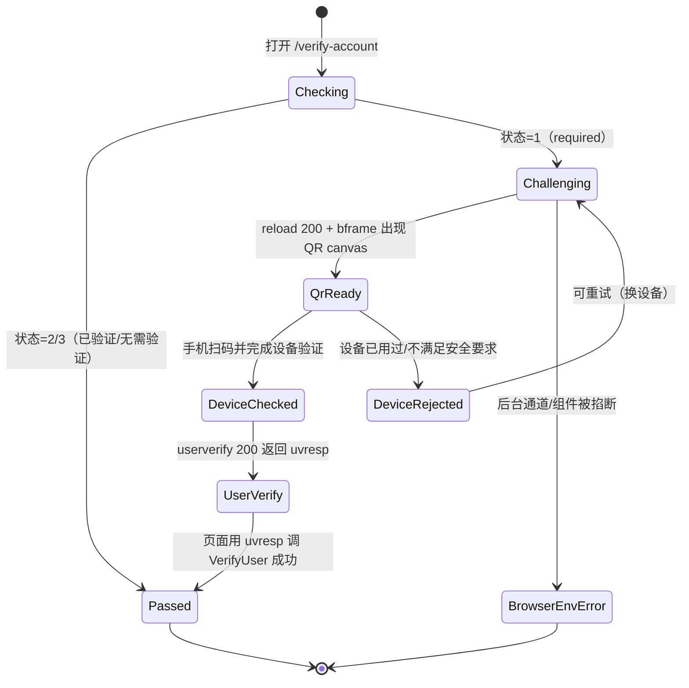

# Google AI Studio 设备验证（verify-account）技术路径

本文记录 Google AI Studio「设备验证」页（`https://aistudio.google.com/verify-account`）的真实调用链、失败语义，以及本服务在该流程中的职责边界与浏览器参数约束。

> 行号基于 2.1.6 发布点，后续以符号名为准。实现引用统一采用「符号名（`文件:行号`）」形式；行号漂移时先按符号名定位。

- **证据口径**：2026-11-24 的实机会话（同一账号、同一网络、同一 CloakBrowser 二进制）与当前仓库代码。文中「本仓实测」仅指该次会话的观测；「社区资料」指公开社区实操，未在本仓独立复现。文中所有 `file:line` 均可在本仓核对。
- **不在本文范围**：BotGuard / WAA 的请求签名链路见 `docs/BOTGUARD_VERIFICATION_CHAIN.md`。

---

## 目录

- [1. 结论摘要](#1-结论摘要)
- [2. Google 侧机制：状态机与时序](#2-google-侧机制状态机与时序)
- [3. 错误文案 → 根因对照表](#3-错误文案--根因对照表)
- [4. iOS 与安卓的差异](#4-ios-与安卓的差异)
- [5. 浏览器启动参数如何把它弄坏](#5-浏览器启动参数如何把它弄坏)
- [6. 验收与状态口径](#6-验收与状态口径)
- [7. 未解问题与边界](#7-未解问题与边界)
- [8. 引用索引](#8-引用索引)

---

## 1. 结论摘要

1. 设备验证是 **reCAPTCHA Enterprise 的 `verify_user` 挑战**：页面出码（bframe 里的 QR canvas），手机完成设备验证后由 reCAPTCHA 返回主令牌，**页面自己**调用 `MakerSuiteService/VerifyUser` 提交令牌。
2. 本服务**不需要自己调 `VerifyUser`**。本服务只做三件事：出码、维持会话窗口、读取上游账号状态（`GetUserVerificationStatus`）。
3. 唯一权威通过判据是 `GetUserVerificationStatus` 的 `200 [2]`（已验证）或 `200 [3]`（无需验证）；`[1]` 一律视为 pending。页面文案、`probe_success`、主框架 `qr_canvas` 只是辅助证据。
4. 浏览器启动参数会直接掐死 reCAPTCHA 依赖的后台通道：同一二进制下，原参数报「浏览器环境级」错误，精简参数后变为「设备级」错误（与真实浏览器同类）。见第 5 章。
5. 扫码设备不在本服务可控范围内。**本仓实测：iOS 16.4+ App Clip 通过一次、安卓被拒；社区资料：安卓存在大面积误杀。** 见第 4 章。

---

## 2. Google 侧机制：状态机与时序

### 2.1 账号侧状态机

`GetUserVerificationStatus` 的响应字段 1 是账号验证状态（静态源码结论见 `docs/dev/rebuild/domains/P1-account/research/verify-account/EVIDENCE.md:147-153`）：

| 值 | 语义 | 本服务处理 |
|---|---|---|
| `1` | `required`（仍需验证） | 保持 pending |
| `2` | `verified`（已验证） | 通过并清锁 |
| `3` | `notRequired`（无需验证） | 通过并清锁 |

页面侧从进入 `/verify-account` 到结束的状态迁移：



> [!IMPORTANT]
> 「页面用 uvresp 调 `VerifyUser`」这一步由 AI Studio 前端自己完成，本服务**不重复调用**。本服务只在扫码后查询 `GetUserVerificationStatus` 判定结果，实现见 `confirm_verified`（`src/aistudio_api/application/verify_account_service.py:2734-2804`）。

### 2.2 页面与 reCAPTCHA 时序

以下为 2026-11-24 同一会话真实抓到的调用序列（按观测顺序；除代码注释记录的关键节点外，精确毫秒未逐条落盘）：

| # | 相对顺序 | 调用 | 结果 | 说明 |
|---|---|---|---|---|
| 1 | 起点 | `GET https://aistudio.google.com/verify-account` | `200` | 验证页 shell 加载 |
| 2 | 随后 | `recaptcha/enterprise.js` → `recaptcha/enterprise/anchor` → `recaptcha/enterprise/bframe` | `200` | reCAPTCHA Enterprise 三段式加载 |
| 3 | 点击/执行后 | `POST recaptcha/enterprise/reload` | `200`，返回 `["rresp", <长令牌>]` | 挑战创建 |
| 4 | 出码 | bframe 内 `canvas.recaptchaJavascriptChallengeQrCanvas` | 可见 | 其 `title`/链接含 `https://recaptcha.net/qr/<短码>`；短码 6~32 位，形如 `KT7YHbLU-g` |
| 5 | 手机完成验证后 | `POST recaptcha/enterprise/userverify` | `200`，返回 `["uvresp", <4729 字符主令牌>, 0, 120, null×5, <130 字符证明串>, null, 1]` | 设备验证回调 |
| 6 | 页面提交 | `POST https://alkalimakersuite-pa.clients6.google.com/$rpc/.../MakerSuiteService/VerifyUser`，body 为 `[[<uvresp 令牌>]]` | 成功 | **页面自己发起**，本服务不调用 |
| 7 | 成功后 | 页面显示 `Your account was verified. You can now continue using AI Studio with this account.` | — | 文案仅作辅助证据 |
| 8 | 状态查询 | `GetUserVerificationStatus` | `[2]` / `[3]` | 权威判据；拒绝时长期停在 `[1]` |

关键耗时：弱机上 bframe 在 `+22s` 左右返回、`reload` 在 `+24s` 左右才发出，因此 20s 的取码预算会把「马上出码」误判为 `qr_timeout`；当前预算为 45s（`DEFAULT_CODE_TIMEOUT_SECONDS`，`verify_account_service.py:97-101`；常量赋值在 `:101`，无环境变量覆盖）。

### 2.3 本服务的取码与状态读取实现

- 导航到 `VERIFY_ACCOUNT_URL` 前会先注入 Cookie 并执行 `bootstrap_google_session`，协商 `accounts.google.com` 侧会话（`CdpVerifyBrowserDriver.start`，`verify_account_service.py:1996-2068`；引导调用 `:2042-2049`）。代码注释记录：跳过这一步时，会出现「真实浏览器能扫、服务侧 `VerifyUser` 403」的偏差（`:2042-2047`）。
- 取码不读主框架，而是遍历 CDP frame tree，只选择 URL 含 `bframe` 或 `recaptcha` 的帧（`_read_bframe_qr`，`:2898-2984`；帧筛选 `:2917-2926`），在帧内读 canvas 的 `title`、`href`、`aria-label` 与 `data:image` 等来源（`_READ_QR_JS`，`:300-328`）。
- 短码由 `_SHORT_CODE_RE = recaptcha\.net/qr/([A-Za-z0-9_-]{6,32})` 提取（`:196`），拼成 `https://recaptcha.net/qr/<短码>` 返回（`:2970-2973`）。
- 会话默认 TTL 300s（`:96`），取码预算 45s（`:101`）；扫码期间每 2s 重试点击可用按钮，只有 bframe 真正给出二维码才判定出码（`_wait_for_qr`，`:2863-2896`）。
- 状态确认由 Python 侧直连 RPC 完成（`httpx` + `SAPISIDHASH`），不依赖 `document.cookie` 与页面 CORS；200 时取响应首元素并解析数值（`confirm_verified`，`:2734-2804`，数组解析见 `:2795-2804`）。

---

## 3. 错误文案 → 根因对照表

以下四条均为 2026-11-24 实机观测原文，可直接作为排障入口。

| 现象 | 含义 | 排查方向 |
|---|---|---|
| 页面 `Something went wrong while verifying your device. Check your connection or browser extensions (such as ad blockers)` | **浏览器环境级**：reCAPTCHA 依赖的后台通道/Google 组件被掐断，挑战根本没走到设备校验 | 检查浏览器启动参数，见第 5 章 |
| 页面 `We couldn't verify your account with this device. ... device has already been used ... or doesn't meet device security requirements` | **设备级**：手机侧额度/安全不满足（与真实浏览器同类报错） | 换 iOS 16.4+ App Clip 设备扫码，见第 4 章 |
| `VerifyUser` → `403`，body `[7,"The caller does not have permission"]` | 服务端不认可这枚令牌的**来路** | 先按前两条定位（浏览器环境、设备），不要改 header 硬闯 |
| `GenerateAccessToken` → `401`，body `[16,"OAuth error: unauthorized_client."]` | 不是成败判据；可能为旁支噪声（同一次会话中成功与失败场景都观测到），也可能是 Cookie 未完整注入的伴随症状，但不是必然规律 | **不要**拿它当根因；以 `GetUserVerificationStatus` 为准 |

补充判读规则：

- `VerifyUser` 403 `[7]` 属于 gRPC `PERMISSION_DENIED`，与 BotGuard 的 403 文案相同但语义不同：这里指 reCAPTCHA 设备验证令牌的来路不被接受，不是 API Key / Cookie 头写错。先确认第 5 章参数与第 4 章设备，再怀疑会话引导（`CdpVerifyBrowserDriver.start`，`verify_account_service.py:2042-2049`）。
- `GenerateAccessToken` 的 401 只是伴随请求，**不是本流程的成败判据**；它可能反映 Cookie 未被完整接受（见 `docs/changelog.md` 2.1.6 的 Cookie 合法化条目），也可能只是旁支噪声。判定始终以 `GetUserVerificationStatus` 的 `2/3` 为准。

---

## 4. iOS 与安卓的差异

### 4.1 本仓实测

- 同账号、同网络、同一浏览器会话下：**iOS 16.4+ 的 App Clip 通过一次；安卓扫码被拒**。
- 结论：拦截点不在账号、不在本服务出口，而在「扫码设备」这一侧。

### 4.2 社区资料（未在本仓独立复现）

- 短码可拼成 `https://appclip.apple.com/id?p=com.google.Recaptcha.VerifyClip&id=<短码>`，直接在 iPhone Safari 拉起 Google 官方轻应用完成验证。
- 安卓侧存在**大面积误杀**（设备安全判定/额度限制）——属社区资料，非本仓逐台复现。

### 4.3 前置条件与产品口径

- 前置条件（平台要求）：iOS 16.4+、使用 Safari（非内嵌 WebView）、系统允许「轻 App」。
- **扫码设备不在本服务可控范围内**。面板与文档必须提示优先使用 iOS；不能承诺任意手机都能通过。
- 面板文案的修改属于 UI 变更，需按 `AGENT.md` §10.2 的 UI 前置确认流程执行；本文只固化技术口径。

---

## 5. 浏览器启动参数如何把它弄坏

### 5.1 实机对照

同一个 CloakBrowser 二进制、同一账号、同一网络：

| 参数集 | 页面结果 | 结论 |
|---|---|---|
| 原启动参数（含下列被剔除项） | `Something went wrong while verifying your device … browser extensions`，出码后 `VerifyUser` 403 | 浏览器环境级失败，流程未到达设备校验 |
| 精简参数（剔除下列项） | `We couldn't verify your account with this device …`，出码正常 | 设备级失败，与真实浏览器同类 |

即：不是浏览器二进制的问题，是我们自己的启动参数掐死了 reCAPTCHA 的后台通道与 Google 组件。对应提交为 `3a72af6`（`fix(verify): 剔除破坏 reCAPTCHA 设备验证的启动参数并去掉固定 UA`）。

### 5.2 逐项说明（依据 `_apply_verify_compat_args`）

实现位于 `src/aistudio_api/application/verify_account_service.py:3241-3271`，注释明确记录上述实机证据（`:3244-3259`）。这些参数在验证浏览器中**无条件剔除**，headless 与 headed 都生效（调用点 `:3225`）。

| 参数 | 为什么移除 |
|---|---|
| `--disable-background-networking` | 直接掐断 reCAPTCHA 的 push/后台通道；设备验证正依赖它（`:3251-3253`） |
| `--disable-component-update` | 关闭 Google 组件更新，而设备校验依赖这些组件（`:3251-3253`） |
| `--disable-default-apps` | 同上，属于设备校验依赖的组件生态（`:3251-3253`） |
| `--disable-features=…` | 过于粗暴：其中包含 `SitePerProcess` 等页面依赖的子系统（`:3254-3255`；默认列表见 `infrastructure/browser/browser_engine.py:185`） |
| `--force-webrtc-ip-handling-policy=…` | 改变网络行为，影响挑战通道（`:3256`） |
| `--no-sandbox` / `--disable-setuid-sandbox`（仅 Windows） | 会触发「不受支持的命令行标志」横条，并移除真实浏览器具备的沙箱（`:3257-3259`） |

说明：同一函数还剔除了 `--disable-speech-api`（`:3265`）。Linux 容器（root）仍需要 `--no-sandbox`，因此这两项只在 Windows 下移除（`:3269-3270`）。

### 5.3 为什么保留这些参数

- **`--disable-site-isolation-trials`（保留）**：bframe 取码依赖同进程帧/隔离世界的可读性；默认启动参数中即存在（`browser_engine.py:165`），验证浏览器不做额外剔除。
- **内存相关参数（保留）**：`--renderer-process-limit=1`、`--in-process-gpu`、`--js-flags=--max-old-space-size=128 …`、SwiftShader 等仍是容器/弱机运行所需（`browser_engine.py:156-166`）。桌面平台默认有头，并自动剔除这些低配机专属参数；非桌面平台默认无头（`_build_verify_chrome_command` / `_verify_headed_enabled`）。

### 5.4 不再注入固定 UA

旧实现会给 headless 注入 `Chrome/133` 的固定 UA；但内核是 146 时 `sec-ch-ua*` 仍描述真实引擎，二者自相矛盾，本身就是异常信号。当前**两种模式（headless / headed）都不注入固定 UA**，统一改用内核原生 UA 与一致的 client hints（`_build_verify_chrome_command`，`verify_account_service.py:3186-3188`）。

### 5.5 诊断开关（不是启动参数逃生口）

`AISTUDIO_VERIFY_MINIMAL_FLAGS` **已在 2.1.6 移除**，不要再使用；如未来需要极简参数档，请新增独立开关，不要复活旧名。当前可用的开关：`AISTUDIO_VERIFY_HEADED`（已废弃，桌面默认有头，`0` 回退无头）、`AISTUDIO_VERIFY_FORCE`（`1`/`0` 强制能力判定）与 `AISTUDIO_VERIFY_DIAGNOSTICS=1`（恢复全部诊断行）。

---

## 6. 验收与状态口径

### 6.1 唯一权威

- `GetUserVerificationStatus` 返回 `200 [2]` 或 `200 [3]` 才清锁；`[1]` 与 `None` 为 pending；未命中显式标记的 401/403、超时与解析失败也保持 pending 等下一次重试。
- 扫码会话内：仅在状态为 2/3 时清锁（`verify_account_service.py:1640-1647`），清锁动作是 `update_account_refresh(..., verify_required=False)` 加 rotator 落盘（`_clear_verify_required`，`:1683-1709`）。
- 独立检查（`POST /verify/check`）：`upstream_status in (2, 3)` 才 `passed` 并清锁（`:1367-1375`）；**凭据文件缺失、Cookie 不可读、缺少 SAPISID、`session_invalid`、`region_blocked` 等返回 `state=error`，不是 pending**（`_perform_check`，`:1265-1382`）。

### 6.2 辅助证据（不得单独作为通过依据）

- 页面成功/失败文案：`_SUCCESS_MARKERS` / `_FAILURE_MARKERS`（`verify_account_service.py:200-212`），判定函数 `_is_success_page` / `_is_failure_page`（`:784-797`）。
- `probe_success`、主框架 `qr_canvas`：只用于日志与诊断（`_log_page_state`，`:2074-2100`；`_DESCRIBE_PAGE_JS`，`:344-363`，由 `_describe_page_snapshot` 在 `:3296-3316` 执行；`_PAGE_SNAPSHOT_JS`，`:330-339` 只返回 url/text）。主框架的 `qr_canvas` 是噪音，真正的二维码在 bframe（`_read_bframe_qr`，`:2917-2926`）。

### 6.3 清锁入口

- `POST /api/accounts/{id}/verify/check`：独立查询，不依赖二维码会话、不启动浏览器、不占实例槽位（路由 `src/aistudio_api/api/routes_accounts.py:1339-1371`；服务实现 `check()` `verify_account_service.py:1212-1263`，status-only driver `_default_status_driver_factory` `:3390-3394`）。
- 返回 `state`（`passed`/`pending`/`error`）、`message`、`upstream_status` 与当前 `verify_required`（`_check_payload`，`:1384-1397`）。
- 面板「检查扫码状态」只看会话；「查询账号状态」直接查上游，两者语义不同（`web/src/components/modals/VerifyAccountModal.vue:864-865`）。

---

## 7. 未解问题与边界

1. **容器内扫码已实测不可用（2026-11-25）**：同一 Windows 主机上，有头 `VerifyUser 200 [2]`、无头 `403 [7]`；即使把无头换成有头参数集仍是 403。VPS Linux 容器即使有头（Xvfb）也 403。因此默认只在桌面平台启用扫码；Linux 返回 501 并引导到电脑端扫码。
2. **强依赖 iOS App Clip**：通过案例来自本仓 iOS 16.4+ 真实设备的一次实测；扫码设备不受本服务控制，安卓误杀属上游行为（社区资料：大面积误杀，未在本仓逐台复现）。
3. **`VerifyUser` 403 `[7]` 的完整触发条件未完全解耦**：已知与「浏览器环境被参数破坏」「设备侧不满足」强相关，但具体到 IP、设备指纹、令牌来路的权重尚未逐项量化。
4. **`GenerateAccessToken` 401 `[16]` 不是判据**：它可能反映 Cookie 未被完整接受（见 changelog 2.1.6 的 Cookie 合法化条目），也可能是旁支噪声；始终以 `GetUserVerificationStatus` 的 `2/3` 为准。
5. **精确时序未全量落盘**：除 bframe `+22s`、reload `+24s` 与 45s 预算外，其余节点只记录顺序，不声称毫秒级时间。
6. **取码超时语义**：20s 预算会产生假 `qr_timeout`；45s 是当前固定预算（`DEFAULT_CODE_TIMEOUT_SECONDS`，`verify_account_service.py:97-101`），未提供环境变量覆盖。
7. **清锁不再依赖前端轮询**：页面级 success 一旦被观测到，服务会为该会话启动一个**有界后台确认任务**（固定退避 2/5/10/30/60/120/300s，总上限 10 分钟），在 `session_lock` 下串行调用 `GetUserVerificationStatus`；返回 2/3 立即清锁并结束，返回 1/None 继续退避，超时只记 INFO、不会强改会话为 `passed`。会话被 `cancel`/`expired`/`error` 之后该任务仍会跑完（`confirm_verified` 只走 httpx，不依赖浏览器页），`close()` 会取消并等待所有未完成任务退出。因此关闭弹窗/标签页休眠不再导致「扫码已通过但锁没清」；启动时仍不会自动对所有 `verify_required` 账号发起查询。

---

### 7.1 电脑端独立扫码助手（tools/verify-helper）

当服务运行在没有桌面浏览器的环境（Linux 容器等）时，`verify/start` 会返回 501 并在面板展示引导。完整流程：

1. 在账号菜单点「导出扫码凭证」，得到 `scan-<account_id>-<date>.json`（含完整登录 Cookie）。
2. 把 `tools/verify-helper/verify_helper.py` 拷到自己的电脑。
3. 在电脑上执行（需 uv）：

   ```bash
   uv run --with "websockets>=13,<16" --with "segno>=1.6,<2" verify_helper.py scan-xxx.json
   ```

4. 助手会启动**有头**浏览器（临时 profile）、注入 Cookie、先访问 `accounts.google.com` 完成会话引导，再进入 `verify-account`、点击 `Verify device`，把二维码保存为临时 `qr.png` 并自动打开，最后按页面文案报告结果。
5. 回到面板点「直接验证账号」复查上游状态并清锁（助手本身不修改账号状态）。

退出码：`0` 页面通过；`2` 设备级拒绝；`3` 环境级失败/超时；`1` 参数、凭证或浏览器错误。凭证 JSON、`qr.png` 与保留的 profile 都含敏感信息，用完请删除。
## 8. 引用索引

| 引用 | 位置 | 用途 |
|---|---|---|
| `verify_account_service.py:88` | `VERIFY_ACCOUNT_URL` | 验证页地址 |
| `verify_account_service.py:96` | `DEFAULT_TTL_SECONDS = 300.0` | 会话窗口 |
| `verify_account_service.py:97-101` | 45s 取码预算注释与常量 | `DEFAULT_CODE_TIMEOUT_SECONDS` |
| `verify_account_service.py:105-108` | `CONFIRM_RPC_TIMEOUT_SECONDS` / `CONFIRM_RPC_INTERVAL_SECONDS` | 状态查询节流 |
| `verify_account_service.py:196` | 短码正则（6~32 位） | 出码解析 |
| `verify_account_service.py:200-212` | 成功/失败文案标记 | 辅助证据 |
| `verify_account_service.py:300-328` | `_READ_QR_JS` | bframe 内 QR 读取 |
| `verify_account_service.py:610-619` | `VerifySessionState` 枚举 | 状态机 |
| `verify_account_service.py:784-797` | `_is_success_page` / `_is_failure_page` | 页面判定 |
| `verify_account_service.py:1212-1263` | `check()` 无会话查询 | 独立清锁 |
| `verify_account_service.py:1265-1382` | `_perform_check`（含凭据/会话错误 → error） | 独立检查语义 |
| `verify_account_service.py:1367-1375` | 2/3 清锁、1/None 保持 pending | 权威口径 |
| `verify_account_service.py:1384-1397` | `_check_payload` | 返回结构 |
| `verify_account_service.py:1640-1647` | 会话内 2/3 清锁 | 权威口径 |
| `verify_account_service.py:1683-1709` | `_clear_verify_required` | 清锁落盘 |
| `verify_account_service.py:1996-2068` | `CdpVerifyBrowserDriver.start` 启动与导航 | 出码链路 |
| `verify_account_service.py:2042-2049` | `bootstrap_google_session` | 避免 VerifyUser 403 |
| `verify_account_service.py:2734-2804` | `confirm_verified` | 状态直连查询 |
| `verify_account_service.py:2863-2896` | `_wait_for_qr` | 45s 取码循环 |
| `verify_account_service.py:2898-2984` | `_read_bframe_qr` | 只读 bframe |
| `verify_account_service.py:2917-2926` | 只选 bframe/recaptcha 帧 | 主框架 canvas 是噪音 |
| `verify_account_service.py:3158-3163` | `AISTUDIO_VERIFY_HEADED` | 有头排查 |
| `verify_account_service.py:251-260` | `_verify_diagnostics_enabled`（`AISTUDIO_VERIFY_DIAGNOSTICS`） | 诊断行开关 |
| `verify_account_service.py:3186-3188` | 不覆盖 UA 的理由 | 固定 UA 移除 |
| `verify_account_service.py:3201-3224` | 有头模式剔除低配参数 | 指纹一致 |
| `verify_account_service.py:3225` | compat 参数调用点 | 无条件生效 |
| `verify_account_service.py:3241-3271` | `_apply_verify_compat_args` | 参数剔除依据 |
| `verify_account_service.py:3390-3394` | `_default_status_driver_factory` | status-only driver |
| `api/routes_accounts.py:1339-1371` | `POST /verify/check` | 清锁入口 |
| `infrastructure/browser/browser_engine.py:148-186` | 默认启动参数全集 | 被剔除项来源 |
| `infrastructure/browser/browser_engine.py:165` | `--disable-site-isolation-trials` | 保留项 |
| `infrastructure/browser/browser_engine.py:185` | `--disable-features=…` 含 `SitePerProcess` | 移除理由 |
| `web/src/components/modals/VerifyAccountModal.vue:864-865` | 两类按钮语义 | 面板口径 |
| `tests/unit/test_verify_account_service.py:1242-1252` | 断言 45s 预算 | 回归保护 |
| `tests/unit/test_verify_account_service.py:877,2996` | 断言保留 site-isolation | 回归保护 |


