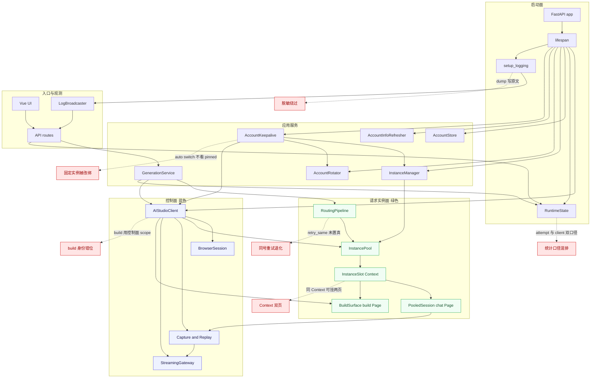
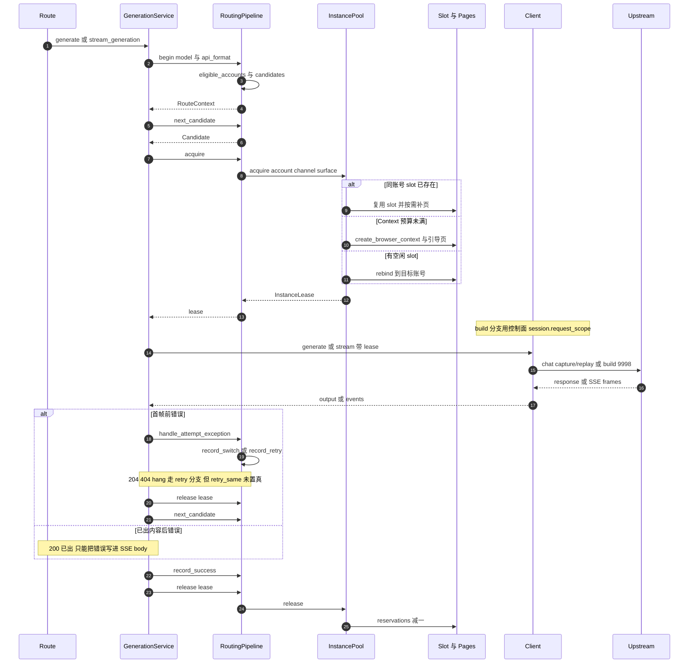
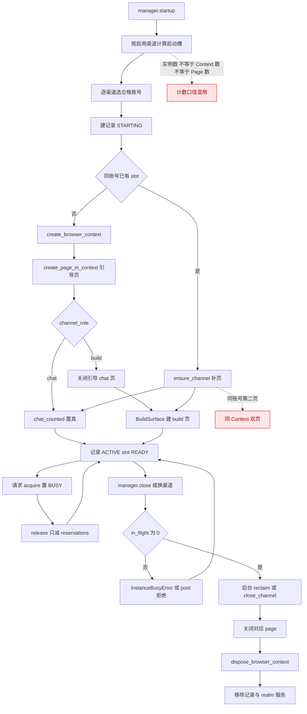
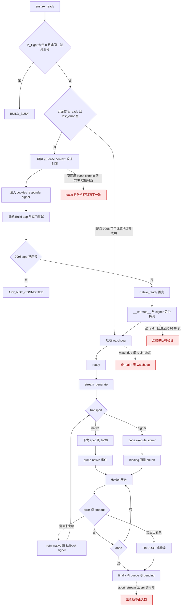
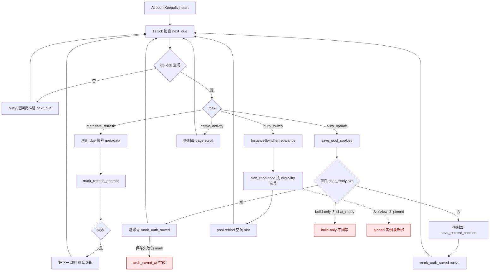
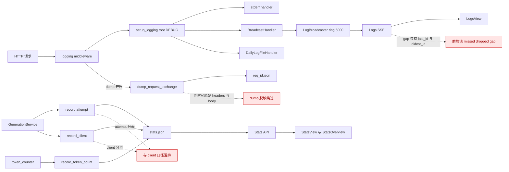

# 07 当前实现架构与生命周期

- 性质：历史快照，基线 `rebuild` @ `e3a77c2`；仅只读参考，不表示当前事实源状态。当前台账/批次已在后续提交跟踪；以 `06-feature-ledger.md` 与 `06-decision-log.md` 为准。
- 范围：当前代码**实际装配与运行路径**，不是 05 的目标架构。仅只读代码与既有文档/证据，不重跑测试、不启动真实 CDP、不访问账号/IP/网络。
- 图例：实线=代码直接调用；虚线=问题标记；红色=已知问题节点；蓝色=控制面；绿色=请求实例面；`待验证`=缺少真实 CDP/集成证据。
- 证据口径：`file:line` 均指当前 `src/aistudio_api`；06 只作交叉索引，不作事实来源。

## 1. 当前运行架构

当前是**控制面 + 请求实例面**双结构：`BrowserSession` 负责控制面浏览器/默认 tab，`InstancePool` 以 `BrowserContext` 为 slot 承载请求；`InstanceManager` 以记录关联 slot，并把 create/close 转调 pool。lifespan 同时启动 warmup、实例 startup、模型发现、keepalive、空闲回收与 tier 校验（`api/app.py:54-267`），并在 `:270-290` 注册四协议 API 与 UI 路由。

- 控制面仍有独立默认 tab 与蓝绿切换（`session.py:221-310`），请求池则用隔离 Context（`instance_pool.py:963-1047`）；两者不是同一套 page 生命周期。
- `InstanceManager` 以 `slot_id` 关联用户记录与 pool，并把 create/close 调用转给 pool；`_max_instances()` 直接等于 `pool.max_contexts`（`instance_manager.py:809-810`）。
- `BuildSurface` 既可由 slot 惰性创建（`instance_pool.py:126-140`），也可由 client 控制面兜底创建（`client.py:219-224`）。
- `RoutingPipeline` 懒绑定当前 runtime client，候选在 `begin()` 冻结（`routing_pipeline.py:241-396`, `:592-614`）。

## 2. 请求生命周期

非流式 `generate` 与流式 `stream_generation` 共用 `_begin_route → next_candidate → acquire → generate/stream → release`；流式另有 `_LeaseHolder` 在生成器取消时兜底释放（`generation_service.py:79-91`, `:851-852`）。

- 候选选择由 `begin()` 一次冻结；`acquire` 失败分两类：build 的 `surface_instance_busy` 只做 1s defer，quota 类才走 `next_candidate`（`generation_service.py:193-251`）。
- `retry_same` 只在 `record_success` 置回 False，`record_retry` 从不置 True（`routing_pipeline.py:514-522`, `:557-559`）；下一轮因此进入 `next_candidate` 换号，且没有 `record_switch` 记账（`generation_service.py:303-315`; `routing_safety.py:58-60`）。
- 流式错误分类传入 `has_yielded_data`；任一内容事件已 yield 后，429/auth 不再切号（`upstream_errors.py:195`, `:230`, `:261`）。
- `thought_signature` 与 `response_id` 只缓冲，不计入 `has_yielded_data`（`generation_service.py:660-663`），因此元数据阶段仍允许换号。
- Gemini 在路由前就返回 `StreamingResponse`，异常只能由生成器写成 SSE 错误块（`api_service_gemini.py:228-263`）；Claude 会先取首个事件，首事件前还能返回真实 HTTP 状态（`routes_claude.py:115-144`）。

## 3. 实例/Context/Page 生命周期

用户可见的“实例”不是 Context 数，也不是 Page 数：manager 记录按 `account+channel` 增长，`startup` 可为同账号不同渠道建两条记录（`instance_manager.py:117-246`），而 pool 同账号第二渠道复用同一 Context 只加页（`instance_pool.py:546-588`）。这与 05 的“一 Context 一 Page”目标直接冲突。

- slot 关闭路径：`close_channel` 先拒绝在途，再只销毁该渠道页（`instance_pool.py:689-719`）；`close_instance` 弹出 slot 后 `close_pages + dispose context`（`:739-750`, `:1214-1231`）。
- build-only 在 `_load_slot` 末尾主动关闭引导 chat 页并设 `slot.session=None`（`instance_pool.py:1028-1036`）；装载期仍真实创建过该页，随后才建 build 页，存在一次额外渲染成本（`:1028-1051`）。
- manager 的在途检查与 pool 的实际关闭不是原子操作：manager 先读 `in_flight` 再调度 reclaim（`instance_manager.py:303-311`），pool 在后续锁内才再次拒绝（`instance_pool.py:745-746`）。
- `_state_from_slot` 把 pool 的 `READY/COOLDOWN` 等一律投影为 `ACTIVE`，而 `COOLDOWN` 在 pool 内无赋值点（`instance_manager.py:990-998`; `instance_pool.py:36-42`）。

## 4. Build Surface 生命周期

Build 面按 slot 惰性创建并绑定该 slot 的 `context_id`（`instance_pool.py:126-140`），但 CDP client 来自控制面 `self._session.ensure_browser_cdp_client()`（`client.py:172-177`）。就绪判定已改为 **native 9998 优先、signer 备用**：9998 连接即 `ready`，signer 后台探测失败不阻塞（`build_surface.py:1156-1187`）。

- 复用快路径要求 `same_auth + page 存活 + ready + last_error 空 + 9998 可达/可恢复`（`build_surface.py:1015-1032`）；新页未就绪会被关闭（`:1180-1186`）。
- `_connections()` 在无 realm 时返回模块级全局表，且 realm 连接也会追加进全局表（`build_surface.py:150-162`）；`D4` 的真实串扰未做 CDP 验证，标 `待验证`。
- watchdog 只在 `_realm_id` 存在时启动（`build_surface.py:1312-1321`），非 realm 仅靠请求路径的 `_recover_warmup` 触发。
- `abort_stream` 只向 task queue 塞 error（`build_surface.py:1844-1854`），src 内无调用方；客户端断开后的取消行为依赖 ASGI/生成器回收，未实测。

## 5. 账号保活与切号

keepalive 是单循环 + 单 job 锁，四类任务按 `next_due` 轮询：metadata、auth update、auto switch、active activity（`account_keepalive.py:175-217`）。调度间隔来自 features，默认值在 `KeepaliveSettings`（`:39-85`）。

- `save_pool_cookies` 只遍历 `slot.session` 且要求 `chat_ready()`（`client.py:187-197`）；build-only slot 的 `session=None`，因此永不被回写。
- `_auth_update` 先保存，再对所有 `chat_ready` slot 无条件 `mark_auth_saved`（`account_keepalive.py:314-325`），保存失败与标记成功脱钩。
- `plan_rebalance` 只看 in-flight/state，`SlotView` 不含 `pinned`（`instance_switch.py:51-68`, `:81-87`）；`pool.rebind` 也不检查 pinned（`instance_pool.py:785-812`）。
- `auto switch` 使用 `eligible_accounts`/groups 做资格筛选（`instance_switch.py:89-136`），与“按 paid/free tier 映射、拒绝策略组”的既有决策冲突（06 D08 已记）。

## 6. 观测链路

日志是 root DEBUG 三 sink：stderr、broadcast ring、daily file（`logger.py:245-297`）；HTTP middleware 负责 access log 与按需 dump（`app.py:376-480`）。统计是 `RuntimeState` 双入口：上游 attempt `record` 与客户端 outcome `record_client`（`state.py:426-470`）。

- `dump_request_exchange` 同时写 `headers`/`raw_body` 和 `safe_headers`/`safe_query_params`（`logger.py:421-441`）；脱敏结果只进 `safe_*`，原始值照样落盘。
- 广播 ring 满时优先淘汰 DEBUG/INFO，保留 WARNING+（`log_broadcast.py:194-201`）；SSE 先订阅再 replay，gap 字段为 `last_id/oldest_id`（`routes_logs.py:34-46`, `:63-65`），前端读 `missed/dropped/gap`（`LogsView.vue:324-329`）。
- 统计写盘 2s debounce / 5s 强制（`state.py:393-418`）；`record` 与 `record_client` 都写入同一 `ModelStatsItem` 的不同字段（`state.py:426-470`），UI 把两套分母并列展示（`StatsOverview.vue:23-26`, `:46-108`）。

## 7. 问题点索引

| 问题 | 图 | 证据 file:line | 影响 |
|---|---|---|---|
| HTTP 200 已出后错误只能进 SSE body | 图2 | `api_service_gemini.py:245-257`, `:259-263` | Gemini 恒 200；客户端无法按状态码重试/换号 |
| `retry_same` 从未置真 | 图2 | `routing_pipeline.py:514-522`; `generation_service.py:305`, `:445`; `routing_safety.py:58-60` | 204/404/hang 的“同号重试”退化为换号，且绕过 `max_switches` 记账 |
| 元数据事件不计入 `has_yielded_data` | 图2 | `generation_service.py:660-663`; `upstream_errors.py:195`, `:261` | 内容事件前可换号、内容后不可；签名/响应 ID 阶段语义不一致 |
| 同账号一 Context 可挂 chat+build 两页 | 图1/图3 | `instance_pool.py:440-454`, `:546-558`, `:642-660`, `:1048-1051` | 偏离 05 单 Context 单 Page；页面与实例预算口径混淆 |
| `max_contexts` 同时是实例/Context/页预算 | 图3 | `instance_manager.py:809-810`; `instance_pool.py:202-211`, `:333-335`; `routing_safety.py:27` | 单实例下 chat/build 互斥，故障转移只剩 1s×2 defer |
| build 请求记控制面 scope，页面却在 lease Context | 图1/图4 | `client.py:589`, `:699`, `:172-177`; `instance_pool.py:131-135`; `session.py:146-160` | 账号身份与在途计数错位，keepalive busy 判定可能失真 |
| 空 realm 的 9998 回退全局连接表 | 图4 | `build_surface.py:150-154`, `:161-162` | 非 realm surface 可能认领其他 realm 的 9998 连接；真实串扰待验证 |
| watchdog 仅 realm 启用，`abort_stream` 无 src 调用方 | 图4 | `build_surface.py:1314-1321`, `:1844-1854` | 非 realm 断线只能等请求触发；无主动中止入口，断开后回收待验证 |
| build-only 不回写 cookie | 图5 | `client.py:187-197`; `account_keepalive.py:320-324`; `instance_pool.py:1028-1036` | build-only 账号 `auth_saved_at` 不前进，长期可能静默失效 |
| auth update 标记成功与保存结果脱钩 | 图5 | `account_keepalive.py:314-325` | 单 slot 保存失败仍标记已保存，掩盖凭据过期 |
| auto switch 不看 `pinned` | 图5 | `instance_switch.py:51-68`, `:81-87`; `instance_pool.py:785-812` | 后台 rebalance 可改绑用户固定实例 |
| dump 文件写原始 headers/body | 图6 | `logger.py:428`, `:433`, `:437`, `:440` | cookie/token 落盘，绕过总线脱敏 |
| 日志 gap 字段前后端不一致 | 图6 | `routes_logs.py:63-65`; `LogsView.vue:324-329` | 缺口提示可能显示空值，用户误以为日志完整 |
| attempt 与 client 双口径混排 | 图6 | `generation_service.py:401-407`, `:497-502`, `:850`; `state.py:426-470`; `StatsOverview.vue:23-26` | 429/错误率分母不一致，面板读数失真 |
| 实例关闭的在途检查非原子 | 图3 | `instance_manager.py:303-311`, `:630-633`; `instance_pool.py:698-699`, `:745-746` | 检查与关闭之间有竞态窗口；关闭失败会把记录回滚为 ACTIVE |
