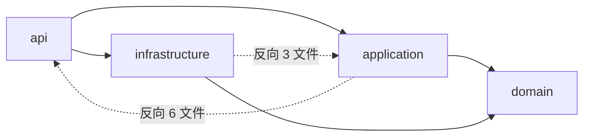

# REV-B7 架构耦合与落地审计

- 审计日期：2026-11-01（UTC+8）。
- 目标树 / HEAD：`D:\LLM\self_programming\aistudio-api\.kilo\worktrees\rebuild-upstream` / `55f1c64`。
- 范围：`99c38ba..HEAD` 落地后的 `src/aistudio_api` 全量静态审计；严格离线，未改代码、未跑服务。
- 方法：AST 跨层 import 边统计、`file:line` 锚点、模块引用计数、决策文档交叉核对。
- 结论：**依赖方向未被强制，D-06 已被代码违反**；存在 3 条 P0 级结构问题、7 条 P1 级重复/泄漏、P2 级死代码/启动耦合/归属整理。以下只列任务，不实施。

## 1. 目标分层与实际情况

目标：`api -> application -> domain <- infrastructure`（domain 不依赖任何层；infrastructure 实现 domain 端口；application 只依赖 domain 端口）。

实际 AST 统计（`src/aistudio_api`，跨层 import 文件数）：

| 边 | 文件数 | 判定 |
|---|---:|---|
| `api -> application` | 11 | 允许 |
| `api -> infrastructure` | 11 | 组合根允许，但存在用例旁路（见 §3.5） |
| `api -> domain` | 5 | 允许 |
| `application -> domain` | 9 | 允许 |
| `application -> infrastructure` | 12 | 具体实现耦合（无端口） |
| **`application -> api`** | **6** | **反向依赖（P0）** |
| **`infrastructure -> application`** | **3** | **循环依赖（P0）** |
| `infrastructure -> domain` | 7 | 允许 |
| `domain -> *` | 0 | 干净 |

结论：名义上的分层存在，但没有编译期/CI 边界；`application` 与 `infrastructure` 互相引用，`application` 还引用 `api` 的 Pydantic 模型、响应模型与全局运行时状态。domain 本身干净，可作为重构落点。

## 2. P0：反向依赖与抽象泄漏

### 2.1 D-06 红线：application 依赖 FastAPI 并构造 HTTP 响应

- **证据**：
  - `src/aistudio_api/application/api_service_gemini.py:15` `from fastapi.responses import StreamingResponse`
  - 同文件 `:17-23` 依赖 `api.response_models`、`api.responses`、`api.schemas`
  - 同文件 `:309-360` `_build_gemini_streaming_response()` 在 application 层预读首事件、构造 `StreamingResponse` 与 SSE 头
  - `api/error_mapping.py:18-23` 反向从 application 导入 `classify_gemini_error_payload`，形成 `api -> application -> api` 回环
  - `api/format_errors.py:12-14,167` 也复用该 application 层分类器
- **决策冲突**：`08-09-decision-record.md:18`（D-06 边界）“不得在 application 层依赖 FastAPI”。
- **影响**：应用层无法脱离 HTTP 框架测试；Gemini 协议渲染事实源在 application，OpenAI 渲染却在 api，协议适配不对称；D-06 的“application 不依赖 FastAPI”已不成立。
- **任务 B7-01**：把 Gemini SSE 渲染、首事件门禁、HTTP 头与 `StreamingResponse` 构造迁到 `api/routes_gemini.py` 或 `api/streaming.py`；application 只返回领域 `StreamEvent` 异步迭代器/`GenerationOutcome`；`classify_gemini_error_payload` 迁到 api 层。
- **验收**：`grep -rn "fastapi" src/aistudio_api/application` 为空；`grep -rn "from aistudio_api.api" src/aistudio_api/application` 为空；Gemini/OpenAI 的 403 四字段、SSE 头、首事件 502 行为由现有路由测试全部通过。

### 2.2 application 反向依赖 api（6 文件）

- **运行时依赖（5）**：
  - `application/token_counter.py:16` → `api.schemas.GeminiGenerateContentRequest`
  - `application/routing_pipeline.py:608,930` → `api.state.runtime_state`（延迟 import + `try/except` 吞异常）
  - `application/account_orchestrator.py:30` → `api.state.runtime_state`
  - `application/api_service_gemini.py:17-23` → `api.response_models` / `api.responses` / `api.schemas`
  - `application/format_converters/openai_request.py:10` → `api.schemas_openai.OpenAIChatRequest`
- **类型期依赖（1）**：`application/chat_service.py:10-15`（`TYPE_CHECKING`）→ `api.schemas` 的 Gemini 请求/Part/Tool 类型。
- **影响**：请求 DTO 的“所有权”在 api，application 无法独立演进；统计记录依赖 API 全局单例；类型期依赖也会把 api 包结构带进 application 的类型检查。
- **任务 B7-02**：把协议请求 DTO 下沉到 `domain/contracts`（或 `application/dto`），api 仅做 HTTP→DTO 的校验/转换；把 `runtime_state` 的统计/rotator 访问改为构造注入的端口（`StatsRecorder`/`RotatorSink`）；删除 application 内的延迟 import 与 `try/except` 静默。
- **验收**：`application/**` 无 `from aistudio_api.api`；路由层构造 DTO 的测试通过；统计记录可用 fake recorder 单测，不依赖全局状态。

### 2.3 infrastructure 反向依赖 application（循环）

- **证据**：
  - `infrastructure/gateway/model_defaults.py:14` → `application.model_access`（`canonical_tier`、`tier_rank` 等）
  - `infrastructure/gateway/instance_pool.py:23-25` → `application.model_access`（`TierSelector`、`resolve_tier_selector`、`tier_matches_selector`）
  - `infrastructure/gateway/model_discovery.py:16,583,596` → `application.model_access`（`is_paid_model`、`tier_satisfies_required`、`minimum_required_tier`）
- **影响**：`application -> infrastructure`（12 文件）与 `infrastructure -> application`（3 文件）构成真实循环；Tier/Paid 领域规则被放在 application，却被 infrastructure 的配置/池/发现反向消费。这也是“配置逻辑落在 gateway”的根因之一。
- **任务 B7-03**：把 Tier/Paid/模型访问规则迁到 `domain/model_access.py`（无框架、无 IO）；application 与 infrastructure 同时依赖 domain；infrastructure 不再 import application。
- **验收**：`grep -rn "from aistudio_api.application" src/aistudio_api/infrastructure` 为空；`model_access` 单测只依赖 domain；导入图无环（可用 import-linter 固化）。

## 3. P1：重复、硬编码与全局状态

### 3.1 配置领域寄生在 infrastructure/gateway

- **证据**：
  - `infrastructure/gateway/model_defaults.py` 共 **1531 行**（`python` 行数），同时承担：深合并、启动校验、非关键回退、feature flags、logging、security、tier_quotas、presets、instance specs、max_contexts、API keys、原子写回。
  - `model_defaults.py:795` 起 `_default_config()` 内置一份默认配置，与 `defaults/config.yaml` 形成双份默认源。
  - 三层缓存并存：`_CONFIG_CACHE`（`:1011`）、`_API_KEYS_CACHE`（`:1012`）、`@lru_cache` 的 `_compiled_profiles`/`_compiled_model_overrides`（`:1089,1101`）；另有 `config.py:325` 的 `settings` 单例。
  - `app.py:280` 启动校验依赖该模块；`routes_system.py` 的配置读写也直接调用它。
- **影响**：配置域规则不可独立测试；gateway 包承担了 application/domain 的职责；默认 YAML 与内置默认可能漂移；缓存失效路径分散（写回只清一部分）。
- **任务 B7-04**：抽出 `config` 领域服务（如 `application/config_service.py` 或 `domain/config` + `infrastructure/config_store.py`），单一负责 merge/validate/cache/write；删除内置默认与 YAML 的重复源（YAML 作为唯一模板，内置仅作最小安全兜底并显式标注）；统一缓存失效入口。
- **验收**：配置读/写/热重载/启动校验的单测只依赖 config service；`defaults/config.yaml` 与内置默认的一致性测试通过；`model_defaults.py` 不再包含 feature/security/quota 等领域分支；`git grep "get_configured_"` 的调用方全部走新服务。

### 3.2 硬编码公共 Web 常量重复

- **证据**（同一组 Google Web 常量）：
  - `infrastructure/account/cookie_parser.py:21-24`：`DEFAULT_API_KEY`、`DEFAULT_EXT_BIN`、`DEFAULT_ORIGIN`、`DEFAULT_USER_AGENT`
  - `infrastructure/account/account_info_refresher.py:44-53`：`RPC_HOST`/`RPC_BASE`/`RPC_URL`/`ORIGIN`/`USER_AGENT`/`DEFAULT_WEB_API_KEY`/`DEFAULT_APP_ID`
  - `infrastructure/gateway/model_discovery.py:675-679`：`ListModels` URL + 同一个 API key + ext-bin 字面量；`:762` 再次硬编码 `ListModels`
  - `infrastructure/gateway/session.py:90-98`：`GenerateContent` URL + 同一个 API key + Referer
  - `infrastructure/gateway/session_auth.py:31-39,191`：登录/新聊天 URL + `GetAiStudioBenefitTier` URL
- **量化**：同一 `AIzaSyDdP8...` 公网 Web key 至少 **4 处**；`/MakerSuiteService/` 基址至少 **5 处**；ext-bin 字面量至少 **2 处**。
- **影响**：上游轮换 key/端点时必须多点修改，易漏；常量散落在 account/gateway/browser 三包；secret scan 会持续告警；测试只能用字符串匹配。
- **任务 B7-05**：建立 `infrastructure/gateway/public_web_constants.py`（或 `domain/public_web.py`）集中定义 key/ext-bin/RPC base/origin/UA/URL 构造器；各模块只引用常量或 helper。
- **验收**：`grep -rn "AIzaSy" src/aistudio_api` 只剩常量模块 1 处（或 0 处，改为配置）；`MakerSuiteService` 只在常量模块出现；相关单测改为引用常量；secret scan 基线下降。

### 3.3 发现/鉴权/Tier 逻辑多实现

#### 3.3.1 模型与 Tier 探测至少 5 条路径

- `infrastructure/gateway/model_discovery.py:675`（浏览器 XHR ListModels）、`:762`（httpx ListModels）
- `infrastructure/account/account_info_refresher.py:46`（HTTP `GetAiStudioBenefitTier`）
- `infrastructure/account/cookie_parser.py:564`（`probe_account_benefit_tier`）、`:654`（ListModels）、`:599`（tier URL）
- `infrastructure/gateway/session_auth.py:191`（浏览器 XHR `GetAiStudioBenefitTier`）
- `application/instance_manager.py:633`（在现有 page 上 standalone ListModels XHR）
- **影响**：超时/代理/错误处理/脱敏/immediate retry 语义各写一份；测试需要多处 fake；一次上游协议变化要改 5 处。

#### 3.3.2 Tier 映射至少 7 份

- `model_access.py:40` `PAID_TIERS`、`:43-50` `_TIER_RANK`、`:54-61` `_TIER_CANONICAL`
- `cookie_parser.py:27-32` `BENEFIT_TIER_TO_NAME`、`:41-47` `_CANONICAL_TIERS`
- `account_info_refresher.py:52` `TIER_BY_CODE`
- `routing_eligibility.py:31` `_PAID_MIN_TIERS`
- `model_defaults.py:42` `_VALID_MIN_TIERS`
- **风险**：`TIER_BY_CODE = {1:"Pro",2:"Ultra",3:"Plus"}` 与 `BENEFIT_TIER_TO_NAME = {0:"Free",1:"Pro",2:"Ultra",3:"Plus"}` 必须手工保持一致；新增 tier 时容易漏改。
- **额外重复**：`instance_pool.py:78-113` 的 `InstanceSpec.selector/accepts_tier` 与 `:181-189` 的 `PoolSlot.selector/accepts_tier` 是同一套 TierSelector 逻辑的两份拷贝。

#### 3.3.3 Paid 事实至少 4 个来源

- `model_access.py:18-38` 内置 `_DEFAULT_PAID_MODELS`
- `model_discovery.py:170-270` fallback 条目内的 `"paid"` 布尔
- `model_defaults.py:1385` 的 `get_configured_paid_model_rules()`（被 `routing_eligibility.py:168-171` 消费）
- `model_discovery.py:300` 的 live `discovery_entry_paid_truth()` / `routing_eligibility.py:134` 的 `_live_paid_truth()`
- **决策冲突**：`06-decision-log.md:56`（D8）“ModelCatalog 是模型/paid 元数据唯一所有者；日志、统计、路由只消费，不各自维护 paid map”。

- **任务 B7-06**：建立单一 `ModelDiscovery`/`TierProbe` 基础设施适配器（HTTP 与浏览器两种 transport 作为策略），统一超时/重试/脱敏；把 Tier 映射收敛到 domain 的单一表；把 Paid 事实收敛到 ModelCatalog/ModelAccess 单一所有者，配置规则只做覆盖。
- **验收**：`ListModels`/`GetAiStudioBenefitTier` 的 URL 与解析各只有 1 处实现；Tier 映射只有 1 张表；Paid 判定只有 1 个入口（配置/live 作为输入）；现有 B6 `live_page` 模型发现与 403 Tier 证据测试通过。

### 3.4 Surface/模型前缀解析不一致

- **证据**：
  - `application/routing_eligibility.py:60-84` `parse_model_surface()`：只接受 `chat/`、`build/`，对 `pg/`、`playground/`、`official/` 抛 `SurfaceUnavailableError`。
  - `application/model_catalog.py:29-36` `split_catalog_prefix()`：接受 `pg`、`chat`、`playground`、`build`，把 `pg/playground` 静默映射为 `chat`；`:43-67` `project_model_ids()` 会输出 `pg/<model>` 别名。
  - `application/format_converters/common.py:strip_models_prefix` 只去 `models/`，不处理 surface。
  - `api/routes_openai.py:100,188` 使用 `strip_models_prefix`/`resolve_model_request`（接受 pg），而 Gemini 路径最终走 `parse_model_surface`（拒绝 pg）。
- **影响**：`/v1/models` 可能向 OpenAI 客户端暴露 `pg/xxx`，但 Gemini 协议对同一前缀返回“旧渠道已移除”；跨协议行为不一致。D-01/P2-A 要求“只有双渠道实际启用且实例分流时才暴露前缀”，当前投影与准入没有共享同一条规则。
- **任务 B7-07**：把 surface 解析/投影收敛为一个 domain 规则（`parse_model_surface` + `project_model_ids` 共用），明确 `pg` 的兼容窗口与拒绝策略；OpenAI/Gemini 路由都调用同一入口。
- **验收**：`pg/`、`build/`、裸 ID 在 OpenAI/Gemini 两协议下的接受/拒绝矩阵有表驱动测试；`/v1/models` 不再输出会被生成路径拒绝的 ID；B6 模型列表数量/前缀断言通过。

### 3.5 错误映射三套与 API 旁路

- **证据**：
  - `application/api_service_gemini.py:87-131` `classify_gemini_error_payload()`（application 层）
  - `api/error_mapping.py:15-136` `error_payload()`（含 gemini/openai/claude/responses 分支，且 `:18-23` 反向调用 application）
  - `api/format_errors.py:146-171` `classify_format_error()`（再调用 application 分类器）
  - `api/routes_logs.py:16` 直接 import infrastructure `log_broadcast`；`api/routes_openai.py:166-169,185-189` 直接 import infrastructure `model_discovery`（用例旁路 application）。
- **影响**：同一异常的状态码/错误类型可能在三处漂移；Gemini 分类器成为事实上的“通用分类器”，但它位于 application；路由可直接触达 infrastructure，绕过 application 用例边界。
- **任务 B7-08**：以 domain 错误为唯一输入，建立 `api/error_mapping.py` 单一协议映射表；删除 application 内的分类器与 api 对 application 的反向 import；路由只通过 application 用例访问发现/日志能力。
- **验收**：异常→(status, body) 只有一条实现路径；403 四字段在 OpenAI/Gemini 下逐字段相等；`api/**` 不再出现“反向 import application 的展示函数”；`grep` 无第二套 `WIRE_TO_*`/状态映射。

### 3.6 流式构造重复（Gemini 在 application，OpenAI 在 api）

- **证据**：
  - Gemini：`application/api_service_gemini.py:309-360` 预读首事件、`assert first_chunk`、构造 `StreamingResponse`、`Cache-Control`/`X-Accel-Buffering` 头。
  - OpenAI：`api/routes_openai.py:111-156` 预读首事件、跳过 `routing_wait`、构造 `StreamingResponse`、同样的头；错误用 `format_error_response`/`openai_sse_error`。
- **影响**：首事件/空流/断连/`aclose`/错误尾帧逻辑两份；协议新增（Claude/Responses）会继续复制；D-06 的 FastAPI 泄漏也由此产生。
- **任务 B7-09**：抽出协议无关的“首事件门禁 + 迭代器关闭 + SSE 头”适配器（api 层），协议 renderer 只负责 chunk/尾帧格式；application 只产出 `StreamEvent`。
- **验收**：OpenAI/Gemini 的“空流→502/错误帧”“首事件前异常→真实 HTTP 状态”“客户端断连→aclose 一次”由共享适配器测试覆盖；两份 `StreamingResponse` 构造只剩 1 处。

### 3.7 全局可变状态

- **证据**：
  - `api/state.py:240` `runtime_state = RuntimeState()`；`api/app.py:369,373,385` 直接赋值；application `routing_pipeline.py:608,930`、`account_orchestrator.py:30` 反向读取。
  - `application/signature_cache.py:158` `signature_cache = ThoughtSignatureCache()`；`api/app.py:23` 直接 import 单例。
  - `application/model_access.py:63-64` `_PAID_MODELS` 可变集合 + `RLock`。
  - `config.py:325` `settings = Settings()`；import 时 `load_dotenv()`。
  - `model_defaults.py:1011-1012` 模块级缓存字典。
  - `application/testing_hooks.py:13-14` 生产模块内的全局计数器（由 `AISTUDIO_TEST_HOOKS` 环境变量门控）。
- **影响**：测试隔离依赖 monkeypatch 顺序；多进程/多 worker 下缓存与 paid 集合不一致；application 通过全局单例隐式依赖 API 生命周期；测试钩子进入生产路径。
- **任务 B7-10**：把 `runtime_state` 拆为显式依赖注入的 ports（stats/rotator/session registry）；`signature_cache`/`model_access` 改为实例化并注入；`testing_hooks` 移到 `tests/support` 或通过显式 `TestHooks` 端口注入。
- **验收**：application 无 `api.state` import；单测可在不初始化 app 的情况下构造 pipeline（fake ports）；`AISTUDIO_TEST_HOOKS` 不再出现在 `src/` 生产路径；并发测试通过。

## 4. P2：死分支、启动编排与遗留模块

### 4.1 死代码、测试专用模块与归属清理候选

| 证据 | 状态 |
|---|---|
| `infrastructure/gateway/wire_parser.py`（633 行） | **生产活跃模块**；被 `client.py`、`streaming.py`、`stream_parser.py`、`wire_codec.py`、`instance_client.py` 直接 import，不属于死代码；仅剩 P2 级归属/API 边界清理（见 B7-11b） |
| `application/format_converters/common.py:56,102,122,130,145` | `map_finish_reason_claude`/`to_claude_usage`/`sse_event`/`text_from_blocks`/`parse_arguments` 仅定义，无调用 |
| `api/format_errors.py:257` | `claude_sse_error` 仅定义；无 Claude 路由 |
| `infrastructure/browser/scripts.py:22,35` + `browser/js/snapshot_probe.js` | `SNAPSHOT_PROBE_JS` 仅加载、`build_snapshot_probe_args` 仅定义；仅语法测试引用（既有 N-32/Q-13） |
| `infrastructure/gateway/model_defaults.py:1413` | `get_configured_formats()` 无调用（formats 实际走 `get_features_config`） |
| `config.py:211` | `build_browser_proxy()` 无调用 |
| `api/dependencies.py:124` | `get_client()` 无调用（路由改用 `get_runtime_state`） |
| `infrastructure/utils/log_broadcast.py:315` | `daily_log_path()` 无调用 |

> **`wire_parser.py` 生产引用（已复核）**：`client.py:36-39`（调用 `:298`、`:378`）；`streaming.py:21-24`（调用 `:149`、`:162`、`:193-196`）；`stream_parser.py:9-13`（调用 `:249`、`:261`、`:277`）；`wire_codec.py:10-13`（调用 `:394`、`:402-407`）；`instance_client.py:27`（调用 `:169`）。测试引用（`test_wire_parser.py` 等）成立，但不能据此判为生产死代码。删除或移入测试支撑会直接破坏非流式/流式响应解析、图片解析、wire codec 与 `countTokens` 路径。

- **任务 B7-11**：删除或接线上表中除 `wire_parser.py` 外的死代码；Claude 脚手架在 P5-Q2 实现前不保留半成品。
- **任务 B7-11b（P2，仅生产模块归属清理）**：`wire_parser.py` 是生产活跃模块，严禁删除或迁入测试支撑。若需降低 gateway 内部耦合，只做 API/归属收敛（例如厘清其与 `stream_parser`/`wire_codec` 的边界、统一解析入口），并保持现有 import 与行为不变。
- **验收**：静态未引用扫描（定义数=1 且非路由/回调）清零或白名单化；`test_wire_parser.py` 继续覆盖生产模块而非“死模块”；无新增未使用公共函数；`wire_parser.py` 的 5 个生产 import 文件在清理后仍可导入并通过现有解析测试。

### 4.2 启动编排集中在 api/app.py

- **证据**：`api/app.py` 802 行；`_warmup_control_session`/`_start_control_warmup`（`:77-102`）、`_startup_instances`（`:105-121`）、`_refresh_model_catalog_once`（`:124-135`）、`_refresh_startup_account_metadata`（`:150-...`）、三个后台任务（`:391`、`:415`、`:442`）、legacy 分支（`:355-357`）。
- **具体缺陷**：`_refresh_startup_account_metadata` 在 keepalive 门控之外无条件执行（`:411`），即 `metadata_refresh=false` / `metadata_refresh_on_startup=false` 时仍可能发起真实 tier/email 探测（既有 N-33 的未闭合子项）。
- **影响**：启动顺序、探测去重、生命周期关闭与 legacy 兼容混在一个模块；测试必须构造完整 app；无法保证“离线/测试无网络”。
- **任务 B7-12**：抽出 `StartupOrchestrator`（或 application 启动用例），把 warmup/metadata/discovery/keepalive 作为显式步骤与开关；删除 legacy 控制面预热分支或改为显式配置模式；metadata 探测与 keepalive 共用同一门控。
- **验收**：`app.py` 只保留 FastAPI 装配与 lifespan 调用的薄层；`test_app_startup_warmup.py` 覆盖“所有开关关闭时零探测”；N-33 子项关闭；关闭顺序仍为“后台任务→keepalive→instance manager→client”。

## 5. D-01..D-14 交叉核对

| 决策 | 结论 | 证据 / 说明 |
|---|---|---|
| D-01 surface + quota_scope | **满足** | `account_rotator.py:73-85`；`model_access.py:40-61`；`routes_system.py:144,183` |
| D-02 pipe watchdog | **满足** | `browser_engine.py:768,1068`；watchdog 仅孤儿回收 |
| D-03 只保留 WS ping | **满足（有张力）** | `cdp_client.py:120-122`；`16450cc` 删除请求级 watchdog，与“命令超时兜底”边界需在后续任务中书面化 |
| D-04 403 不切号/四字段 | **满足** | `domain/errors.py:24-61`；`routing_pipeline.py:628-629` |
| D-05 控制面有界 rebind | **满足** | `instance_manager.py:10,39,516,905`；`instance_pool.py:8-9,45` |
| D-06 application 不依赖 FastAPI | **违反** | `api_service_gemini.py:15,309-360`；`api/error_mapping.py:18-23` |
| D-07 深合并 + 启动校验 | **满足** | `model_defaults.py:1065-1085`；`app.py:280` |
| D-08 presets 锁/写失败 | **满足** | `account_store.py:299-321`（RLock + presets.json） |
| D-09 hash 含代码 | **满足** | `session.py:65-83`；`signature_cache.py` |
| D-10 有界 drain | **满足** | `instance_manager.py:39,144-150,905` |
| D-11 关闭非活跃页 | **满足** | `instance_pool.py:8-9`；`instance_manager.py` RETIRING/prune |
| D-12 新设置进现有 UI | **部分/延后** | `08-09:24` 要求 `quota_scope`/API 免密开关在现有卡片可见；`web/` 对 `quota_scope`、`api_allow_anonymous` 无结构化引用，仅 YAML 编辑器可改 |
| D-13 删除 notes/批量分组 | **满足** | 仅测试断言不存在：`test_routes_account_presets.py:132-135`、`test_routes_accounts.py:77` |
| D-14 API/管理页鉴权分离 | **满足** | `dependencies.py:69-121`；`model_defaults.py:1486-1505`；`app.py:454-471` |

> D-12 的 UI 工作按既有口径属 C2/P8；本审计只标记“HEAD 未满足”，不作为 B 阶段回归。

## 6. 未闭合 Q/N 状态（与耦合审计相关）

| 项 | HEAD 状态 | 证据 |
|---|---|---|
| Q-05 上游 SettingsView 文案替换 | **OPEN（非阻断）** | `web/src/views/SettingsView.vue:67,73`；来自上游 `ccd15e3` |
| Q-12/N-40 实时 B6 验证 | **已闭合（证据）** | `docs/dev/evidence/B6/results.json`：5/5 generation、31 models、403 双协议 |
| Q-13/N-32 `snapshot_probe` 未接线 | **OPEN（非阻断）** | `scripts.py:22,35`；仅 `test_browser_scripts_syntax.py:25,187` 引用 |
| N-33 配置门控子项 | **OPEN（非阻断）** | `app.py:397-413`：keepalive 门控内，但 `_refresh_startup_account_metadata` 在 `:411` 无条件调用 |
| N-42 手动 detect 路由 ISO 单测 | **OPEN（非阻断）** | 代码已写 `checked_at`，缺直接单测 |
| N-43（N-33 拆分） | **OPEN（非阻断）** | 同上 |
| P4-Q4 native/signer 重审 | **PENDING（阶段外）** | `06-decision-log.md:206,214,227` |
| P1-E2 OAuth/refresh_token | **DEFER** | `06-decision-log.md:92-96` |
| P5-Q11 build REST | **DEFER** | `06-decision-log.md:286` |
| P6-Q6 active_activity | **DISABLE** | `06-decision-log.md:437` |
| P10-Q3 WARP 小流量 | **后置** | `06-decision-log.md:411` |

## 7. 《B 阶段后独立架构微调与解耦施工清单》

> 本清单按严重度排序；每项可独立开分支/任务，不改业务语义。P0 项建议在 C 阶段前完成；P1 项可在 C2 UI/Claude 前完成；P2 项可并行清理。

| ID | 严重度 | 发现（证据） | 独立任务 | 验收 |
|---|---|---|---|---|
| **B7-01** | P0 | application 依赖 FastAPI 并构造 `StreamingResponse`（`api_service_gemini.py:15,17-23,309-360`）；D-06 红线 | 把 Gemini SSE 渲染/首事件门禁/HTTP 构造迁到 api；application 只返回 `StreamEvent` 迭代器；`classify_gemini_error_payload` 迁 api | `application/**` 无 `fastapi`/`aistudio_api.api` import；Gemini/OpenAI 流式与 403 测试全绿；空流仍 502 |
| **B7-02** | P0 | application→api 反向依赖 6 文件（`token_counter.py:16`、`routing_pipeline.py:608,930`、`account_orchestrator.py:30`、`api_service_gemini.py:17-23`、`openai_request.py:10`、`chat_service.py:10-15`） | DTO 下沉 domain/application；`runtime_state` 改注入端口；删除延迟 import/静默 `except` | 反向 import 清零；pipeline 可在无 app 初始化下单测；统计/rotator fake 注入测试通过 |
| **B7-03** | P0 | infrastructure→application 循环（`model_defaults.py:14`、`instance_pool.py:23-25`、`model_discovery.py:16,583,596`） | Tier/Paid 规则迁 `domain/model_access.py`；两层的 import 改指向 domain | `infrastructure/**` 无 `aistudio_api.application` import；import-linter/ruff TID 规则纳入 CI |
| **B7-04** | P1 | 配置域寄生 gateway：`model_defaults.py` 1531 行、内置默认 `:795`、三层缓存 `:1011-1012,1089,1101`、`config.py:325` 单例 | 抽 config service + store；YAML 单一默认源；统一缓存失效 | 配置单测只依赖 service；默认源一致性测试；`model_defaults` 仅保留 gateway 适配 |
| **B7-05** | P1 | 公共 Web 常量重复：key 4 处、RPC base 5 处、ext-bin 2 处（`cookie_parser.py:21-24`、`account_info_refresher.py:44-53`、`model_discovery.py:675-679,762`、`session.py:90-98`、`session_auth.py:31-39,191`） | 建立单一 `public_web_constants` 模块并替换 | `grep "AIzaSy"` 仅在常量模块；`MakerSuiteService` 仅常量模块；相关测试改用常量 |
| **B7-06** | P1 | 发现/Tier 多实现：5 条探测路径、7 张 Tier 表、4 个 paid 来源；`instance_pool.py:78-113` 与 `:181-189` 重复 selector | 单一 `TierProbe`/`ModelDiscovery` + 单张 Tier 表 + ModelCatalog 单一 paid 所有者 | ListModels/BenefitTier 各 1 实现；Tier 表 1 份；paid 判定 1 入口；B6 证据回归 |
| **B7-07** | P1 | surface 解析不一致：`routing_eligibility.py:60-84` 拒绝 `pg/`，`model_catalog.py:29-36,43-67` 接受并投影 `pg/` | 统一 surface 解析/投影规则；明确 `pg` 兼容窗口 | OpenAI/Gemini 前缀矩阵表驱动测试；`/v1/models` 不输出会被拒绝的 ID |
| **B7-08** | P1 | 错误映射三套且回环：`api_service_gemini.py:87-131`、`error_mapping.py:18-136`、`format_errors.py:146-171`；API 旁路 infra（`routes_logs.py:16`、`routes_openai.py:166-169`） | 单一 domain→protocol 映射；路由只走 application 用例 | 异常→(status,body) 单路径；403 四字段跨协议一致；无反向 import |
| **B7-09** | P1 | 流式构造重复：`api_service_gemini.py:309-360` vs `routes_openai.py:111-156` | 抽 api 层协议无关流适配器 | 两份 `StreamingResponse` 构造合一；空流/断连/aclose 共享测试 |
| **B7-10** | P1 | 全局状态：`state.py:240`、`signature_cache.py:158`、`model_access.py:63-64`、`config.py:325`、`model_defaults.py:1011-1012`、`testing_hooks.py:13-14` | 显式 DI + 实例化缓存；test hooks 移出生产 | application 无 `api.state`；无 `AISTUDIO_TEST_HOOKS` 生产分支；并发测试通过 |
| **B7-11** | P2 | 死代码/测试专用：Claude 脚手架（`common.py:56,102,122,130,145`、`format_errors.py:257`）、`snapshot_probe`（`scripts.py:22,35`）、`get_configured_formats:1413`、`build_browser_proxy:211`、`get_client:124`、`daily_log_path:315` | 删除或接线 | 未引用公共函数清零/白名单；无测试依赖生产死模块 |
| **B7-11b** | P2 | 生产活跃模块归属清理（非死代码）：`wire_parser.py`（633 行）被 `client.py:36-39,298,378`、`streaming.py:21-24,149-196`、`stream_parser.py:9-13,249-277`、`wire_codec.py:10-13,394-407`、`instance_client.py:27,169` 使用 | 仅做 gateway 内部 API/归属收敛；不得删除或迁测试支撑 | 5 个生产 import 保留；现有解析/`countTokens` 测试通过；无行为变化 |
| **B7-12** | P2 | 启动编排 802 行、3 个后台任务（`app.py:391,415,442`）、legacy 分支（`:355-357`）、N-33 无条件探测（`:411`） | 抽 `StartupOrchestrator`；统一 metadata 门控；legacy 分支显式化/删除 | `app.py` 薄层化；开关全关零探测测试；关闭顺序回归 |
| **B7-13** | P2 | 测试钩子与单例（`testing_hooks.py:13-14`；`signature_cache` 全局） | 注入 `TestHooks` 端口；缓存实例化 | 生产路径无测试环境变量；测试隔离无顺序依赖 |
| **B7-14** | P1（跨项） | 无编译期/CI 分层边界；当前循环依赖可长期存在 | 引入 import-linter（或 ruff TID）规则：domain 无依赖；application 禁 api/fastapi；infrastructure 禁 application；api 禁反向 application 展示函数 | CI 在新增违规时失败；B7-01/02/03 完成后规则转绿 |

## 8. 残余风险与说明

1. **未实施任何修复**：本文件只给任务与验收，不包含代码变更。
2. **静态结论**：层间 import 由 AST 扫描与人工抽查得出；“未引用”由全仓文本计数 + 抽查确认，仍可能有动态引用/测试字符串未覆盖。
3. **上游张力**：`16450cc` 删除请求级 watchdog，D-03 要求“命令超时兜底”；两者不一定冲突（D-03 指 CDP 命令超时，上游删的是请求级全局 watchdog），但需要一份书面边界，避免后续误恢复。
4. **D-12 与 C2**：UI 可见性按既有计划延后；若 C2 不实现，则 D-12 从“延后”转为“违反”。
5. **配置双源**：`defaults/config.yaml` 与 `model_defaults._default_config()` 的差异未逐键比对；B7-04 应加入一致性测试，防止新键只进一处。
6. **构建产物**：`424f896` 提交了 `src/aistudio_api/static/assets/*` 构建产物；后续审计/评审需区分源码与产物，避免把 vendor 变更当作业务逻辑。
7. **P4-Q4/P5-Q11** 等阶段外未闭合项不在本清单内，保持原决策状态。
