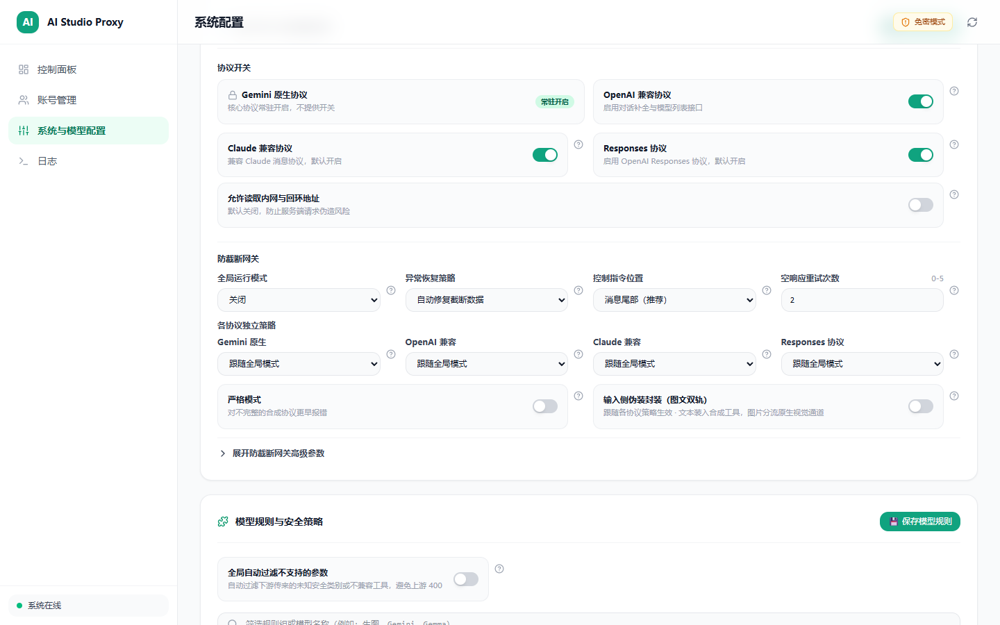

# REV-2.1.4-atg-input-wrap — ATG 输入侧伪装工具调用（`wrap_input`）与图文双轨分流独立审查报告

- **审查对象**：ATG 输入侧伪装工具调用（`wrap_input`）+ 图片多模态双轨分流 + 继承各协议独立策略（`mode_by_format`）前后端改动
- **审查角色**：独立只读 Reviewer（`REV-2.1.4-atg-input-wrap`）
- **审查日期**：2026-11-13
- **最终判定**：**PASS**

> **只读声明**：本审查严格遵守只读审计边界，未修改任何业务源码或测试文件，未在非 `--ui-debug` 模式下启动服务，未执行 `git commit` 或 `git push`；仅按任务授权写入本报告、`assets/c214-atg-wrap-input-1440.png`、更新 `docs/dev/rebuild/domains/P5-generation/index.md` 与 `docs/changelog.md`。

---

## 1. 审查范围与改动盘点

### 后端与配置契约
- `src/aistudio_api/application/atg/input_wrapper.py`（新增，215 行）
- `src/aistudio_api/application/atg/config.py`（`AtgConfig.wrap_input`、`resolve_atg_mode(cfg_or_format, api_format)`、`to_dict`、`load_atg_config`）
- `src/aistudio_api/application/atg/history_purge.py`（双前缀 `tool_prefix` + `atg_ctx_`、锚点 `INIT_CONTEXT_TEXT`、`tools` 与 `allowedFunctionNames` 清洗）
- `src/aistudio_api/application/atg/injector.py`（`detect_client_synthetic_transport` → `purge_synthetic_history` → `wrap_input_contents` 顺序接入）
- `src/aistudio_api/application/atg/__init__.py`（`AtgProcessor.wrap(..., api_format=...)` 策略继承）
- `src/aistudio_api/infrastructure/gateway/model_defaults.py`（`features.atg.wrap_input` 非布尔值回退 `False` 并记录 `WARNING`）
- `defaults/config.yaml` / `defaults/config.schema.json`（新增 `features.atg.wrap_input: false`）
- `tests/unit/test_atg_input_wrapper.py`（新增，486 行）/ `tests/unit/test_atg_config.py`

### 前端与静态产物
- `web/src/components/settings/ProtocolAtgCard.vue`
- `web/src/components/config/schema.ts`
- `web/src/types/system.ts`
- `web/tests/configTooltip.test.ts` / `web/tests/dashboardStatsUi.test.ts`
- `src/aistudio_api/static/assets/SettingsView.js`（已同步构建产物）

---

## 2. 核心需求逐项核验（file:line）

### 2.1 `wrap_input` 100% 继承 `resolve_atg_mode(cfg, api_format)`
- **路由入口传参**：四协议入口均向 `generation_service.generate` / `stream_generation` 显式传入 `api_format`：
  - `src/aistudio_api/api/gemini_service.py:63,228` 与 `routes_gemini.py:59`（`api_format="gemini"`）
  - `src/aistudio_api/api/routes_openai.py:125,134`（`api_format="openai"`）
  - `src/aistudio_api/api/routes_claude.py:95,194,236`（`api_format="claude"`）
  - `src/aistudio_api/api/routes_responses.py:123,132,220`（`api_format="responses"`）
- **请求期解析与 `off` 零侵入**：
  - `src/aistudio_api/application/generation_service.py:98-106`（`_create_atg`）调用 `resolve_atg_mode(api_format)` 并构造 `AtgProcessor(load_atg_config({"mode": resolved}))`。当某协议策略为 `off`（含 `inherit -> off`）时，`atg.enabled` 为 `False`（`config.py:134`），`_wrap_atg_request`（`generation_service.py:116-117`）直接原样返回 `req, ""`，绝不触发 `wrap_input`。
  - 直接调用 `AtgProcessor.wrap(body, model_name, api_format=...)` 时（`src/aistudio_api/application/atg/__init__.py:51-75`），先通过 `resolve_atg_mode(self.cfg, api_format)` 计算 `effective_mode`（`config.py:44-80`）：若 `effective_mode == "off"` 直接返回未包装 `WrapResult`（`__init__.py:64-69`）；若 `effective_mode != self.cfg.mode`，通过 `replace(self.cfg, mode=effective_mode)` 重建 `Injector`（完整保留 `wrap_input` 等字段，`__init__.py:72-73`）。
  - `Injector.inject_gemini`（`injector.py:111-112`）再次守卫 `if cfg.mode == "off"`，并在 `cfg.wrap_input` 为 `True` 时（`injector.py:150-154`）执行 `wrap_input_contents(body)`。
- **配置校验与默认值**：
  - `defaults/config.yaml:178`、`defaults/config.schema.json:365`、`config.py:121,202` 默认 `wrap_input: false`。
  - `model_defaults.py:307-317` 对非法 `features.atg.wrap_input` 显式记录 `logger.warning` 并回退 `False`。

### 2.2 `detect_client_synthetic_transport` 先于 `wrap_input_contents` 执行（防 `history-loop` 自伤）
- **执行顺序**：`src/aistudio_api/application/atg/injector.py:133-154` 严格按以下顺序执行：
  1. `injector.py:133-143`：`detect_client_synthetic_transport(body, self._prefix)` 扫描客户端原生请求；若命中客户端自有合成传输工具（如 `atg_emit_*` 等），直接返回 `synthetic_hit=False`，同时跳过 `wrap_input` 与输出侧包装。
  2. `injector.py:145-148`：`purge_synthetic_history(body, self._prefix)` 清理历史残留的 `atg_emit_*` 与 `atg_ctx_*` 片段、`INIT_CONTEXT_TEXT` 锚点及 `tools`/`allowedFunctionNames` 中的 `atg_ctx_*`（`history_purge.py:28-150`），防止多轮重放嵌套。
  3. `injector.py:150-154`：`if cfg.wrap_input: wrap_input_contents(body)`。
- **反自伤特征核验**：对照 `src/aistudio_api/application/atg/client_patterns.py:26-59,120-227`：
  - `atg_ctx_<12位hex>`（`input_wrapper.py:121`）不含 `TOOL_NAME_PATTERN` 关键词（`[0-9a-f]` 无法构成 `emit`/`deliver` 等词）；
  - 参数为 `{"type": "OBJECT", "properties": {"scope": {"type": "STRING"}}}`（`input_wrapper.py:166-169`），`scope` 不在 `CONTENT_PARAM_NAMES`；
  - 描述 `"Historical context loader (already executed in history; DO NOT call this tool again)."` 不匹配 `DECLARATION_DESC_PATTERN`；
  - `INIT_CONTEXT_TEXT` 与 `CONTEXT_INSTRUCTION` 不匹配 `INSTRUCTION_PATTERN`。
  - 因此即使客户端回传历史 `atg_ctx_*` 对话，也不会误触 `history-loop`；且先 `purge_synthetic_history` 再重包可保证仅保留单层最新 `atg_ctx_*`。

### 2.3 3-Turn 双轨拓扑与 `normalize_gemini_request` / `AistudioWireCodec.encode` 100% 兼容
- **非工具链守卫**：`input_wrapper.py:30-45,58-59` 若 `contents` 已包含真实 `functionCall` 或 `functionResponse`，立即原样返回，不破坏既有业务工具链。
- **3-Turn 结构与双轨分流**（`input_wrapper.py:61-187`）：
  - **Turn 0**（`input_wrapper.py:124-127`）：`role="user"`，`parts=[{"text": "Initialize context retrieval."}]`。
  - **Turn 1**（`input_wrapper.py:128-140`）：`role="model"`，`parts=[{"functionCall": {"id": call_id, "name": ctx_tool_name, "args": {"scope": "conversation"}}, "thoughtSignature": DUMMY_THOUGHT_SIGNATURE}]`，满足 PG-01 思维签名硬约束。
  - **Turn 2**（`input_wrapper.py:141-158`）：`role="user"`，`parts[0]` 为 `functionResponse`（`response` 携带 `conversation_turns`、`attached_media_count` 与 `instruction`，`conversation_turns` 保留各轮 `index`/`role`/`content` 及 `thought` 摘要并用 `[Attached Media #k: <mime>]` 锚定媒体序号），随后 `*media_parts` 将提取出的 `inlineData` / `fileData` 原生媒体 Part 同轮并置。
  - **声明与白名单合并**（`input_wrapper.py:160-205`）：在 `tools[0]["functionDeclarations"]` 注册 `ctx_declaration`；若存在非空 `toolConfig.functionCallingConfig.allowedFunctionNames`，追加 `ctx_tool_name`（后续 `injector.py:193-201` 再追加 `atg_emit_*`），确保通过 `wire_codec.py:343-357` 的白名单过滤。
- **下游编解码兼容性核验**：
  - `GeminiGenerateContentRequest.model_validate`（`contracts/gemini.py:50-198`）与 `normalize_gemini_request`（`chat_service.py:803-921,1113-1132`）完整解析 Turn 0 文本、Turn 1 `functionCall` + `thoughtSignature`、Turn 2 `functionResponse`（Struct dict）及同轮 `inlineData`（同时写入 `contents[2].parts` 与 `capture_images`）。
  - `AistudioWireCodec.encode`（`wire_codec.py:198-236`）结合 `AistudioPart.to_wire`（`wire_types.py:247-298`）将 Turn 1 编码至 `PartIndex.FUNCTION_CALL_ALT`（`[10]`）+ `PartIndex.THOUGHT_SIGNATURE`（`[14]`），将 Turn 2 编码至 `PartIndex.FUNCTION_RESPONSE_ALT`（`[11]`）及 `PartIndex.INLINE_DATA`（`[2]`），端到端单元测试 `test_wrap_input_dual_track_media_end_to_end_wire_slots` 实跑通过。

### 2.4 前端 `ProtocolAtgCard.vue` 布局、文案与 Tooltip 规范
- `web/src/components/settings/ProtocolAtgCard.vue:268-324`：在「各协议独立策略」4 列下拉选择器正下方（`lines 294-324`）使用 `
` 并排渲染：
  - 左侧：「严格模式」（`asBool(atg.strict, false)`，`schema-key="features.atg.strict"`）
  - 右侧：「输入侧伪装封装（图文双轨）」（`asBool(atg.wrap_input, false)`，副标题 `跟随各协议策略生效 · 文本装入合成工具，图片分流原生视觉通道`，`schema-key="features.atg.wrap_input"`）
- `web/src/components/config/schema.ts:1177-1187` 补齐 `features.atg.wrap_input` 规范字典条目（`defaultValue: false`、`recommendedValue: false`），与 `defaults/config.yaml:178` 对齐并通过 `configTooltip.test.ts:85` 校验。
- `web/src/types/system.ts:100-124` 补充 `AtgMode`、`AtgFormatOverrideMode`、`AtgModeByFormat`、`AtgConfig` 类型定义。

---

## 3. `--ui-debug` 沙盒 + Playwright 实测与截图验证

- **沙盒启动**：通过 `background_process` 启动 `uv run python main.py server --port 18093 --ui-debug`（`pid=5760`，纯内存隔离沙盒）。
- **1440×900 视口实测**（访问 `http://127.0.0.1:18093/settings` 并滚动至「协议开关与防截断网关」卡片）：
  - `docScrollWidth = 1440`，`innerWidth = 1440`，无横向溢出（`docOverflow: false`）。
  - 「严格模式」与「输入侧伪装封装（图文双轨）」位于同一行并排展示（`strictRect.y = 568.125`，`wrapRect.y = 568.125`，`strictRect.x = 328`，`wrapRect.x = 869`）。
  - Tooltip 交互（hover `features.atg.wrap_input` `?` 图标）正常弹出：`业务原理: 开启后将对话输入文本封装进合成工具返回结构（atg_ctx_*），同时自动将图片分流至原生视觉通道以完整保留多模态看图能力。默认关闭。`
  - 浏览器控制台错误/警告数：`0 Errors, 0 Warnings`。
  - 归档截图：`docs/dev/rebuild/domains/P5-generation/reviews/assets/c214-atg-wrap-input-1440.png`（已读取图像确认布局、文案、开关与图标渲染完整无裁切）。
- **768×900 视口实测**：
  - `docScrollWidth = 768`，`innerWidth = 768`，无横向溢出（`docOverflow: false`）。
  - 「严格模式」与「输入侧伪装封装（图文双轨）」在 `md:grid-cols-2` 断点下并排无重叠（`strictRect.x = 64, y = 704`，`wrapRect.x = 405, y = 704`）。
  - 悬浮 Tooltip 位于视口安全区内（`left = 455, right = 745, width = 290 <= 768`），未出界。
- **资源清理**：已执行 `playwright_browser_close` 与 `background_process(action="stop", id="bgp_1d347502a001HRRFjOTeGZb3j3")`，端口与沙盒进程完全释放。

---

## 4. P0 / P1 / P2 / Q / N 问题清单

- **P0（阻塞性问题）**：无
- **P1（重要缺陷）**：无
- **P2（一般改进）**：无
- **Q（待确认疑问）**：无
- **N（非阻塞观察注记）**：
  - **N1**：`src/aistudio_api/application/atg/__init__.py:84-90` 中 `AtgProcessor.unwrap_response` 检查 `if not self.enabled or not tool_name or self._extractor is None:`。主链 `generation_service._create_atg`（`generation_service.py:106`）已预先解析 `resolve_atg_mode(api_format)` 覆盖 `cfg.mode`，因此生产主链下 `self.enabled` 与按协议策略完全一致；若未来有外部调用方直接构造全局 `AtgProcessor`（全局 `mode="off"` + `mode_by_format.openai="prefer"`）并先后调用 `wrap(..., api_format="openai")` 与 `unwrap_response`，`self.enabled` 仍为 `False`（而 `create_stream_unwrapper` 不受 `self.enabled` 限制）。当前无实际故障，可留作后续门面一致性微调参考。
  - **N2**：`src/aistudio_api/application/atg/input_wrapper.py:89-99` 对 `fileData` Part 做了与 `inlineData` 对称的双轨分流保留，但下游 `chat_service.normalize_gemini_request`（`chat_service.py:912-913`）对 `fileData` 仍固定抛出 `ValueError("fileData is not supported yet")`（已有前置基线限制；OpenAI/Claude/Responses 图片均已转为 `inlineData`）。
  - **N3**：`src/aistudio_api/application/atg/input_wrapper.py:75-107` 仅提取 `inlineData`、`fileData` 与 `text`/`thought`，不透传 `executableCode`/`codeExecutionResult` Part；鉴于输入侧封装定位为无业务工具链的纯文本/多模态对话，不影响当前交付边界。

---

## 5. 全套验收门禁实跑结果

| 门禁命令 | 实跑结果 |
|---|---|
| `uv run ruff check .` | `All checks passed!`（0 errors） |
| `uv run pyright src tests` | `0 errors, 0 warnings, 0 informations` |
| `$env:PYTHONUTF8='1'; uv run pytest -q` | `1493 passed in 51.07s` |
| `cd web && bun run lint && bun run type-check && bun test` | `eslint` 0 errors / 0 warnings；`vue-tsc -b` 0 errors；`bun test` `95 pass, 0 fail`（781 expect() calls） |
| `git diff --check` | 无空白/行尾格式错误（0 errors） |
| `git ls-files config.yaml` | 输出为空（本地 `config.yaml` 未纳入版本控制） |
