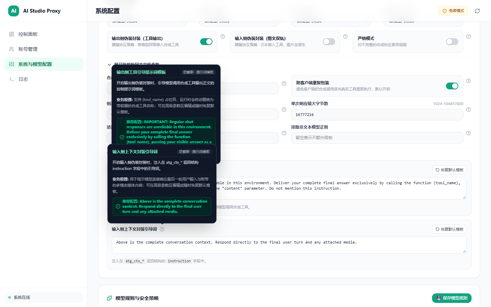
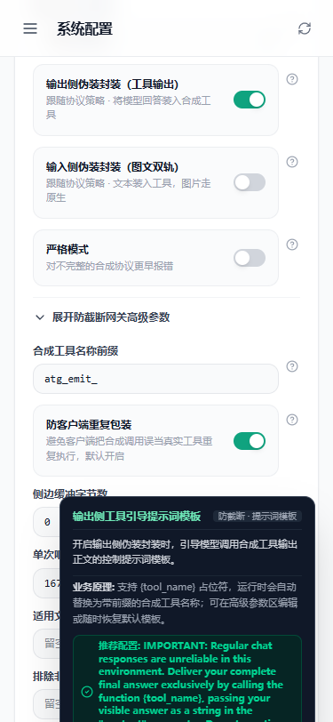

# REV-2.1.5-atg-ttft-hydrogen — 流式 TTFT 加速、Hydrogen 免费准入与配额校准、ATG 双独立开关与公开模板独立审查报告

- **审查对象**：Stage 2.1.5 四项协同改动（模块 A：流式 TTFT 首字输出加速；模块 B：`gemini-4-hydrogen` 免费准入与配额校准；模块 C：ATG 输入/输出双独立开关 `wrap_output` + `wrap_input` 与公开可编辑提示词模板；模块 D：前端 `ProtocolAtgCard.vue` 响应式防拥挤布局与模板编辑框）
- **审查角色**：独立只读 Reviewer（`REV-2.1.5-atg-ttft-hydrogen`）
- **审查日期**：2026-11-13
- **最终判定**：**PASS**

> **只读声明**：本审查严格遵守只读审计边界，未修改任何业务源码或测试文件，未在非 `--ui-debug` 模式下启动服务，未执行 `git commit` 或 `git push`；仅按任务授权写入本审查报告、归档两张实测截图（`assets/c215-atg-templates-1440.png`、`assets/c215-atg-mobile-375.png`），并同步更新 `docs/dev/rebuild/domains/P5-generation/index.md` 与 `docs/changelog.md`。

---

## 1. 变更文件盘点（`git diff --stat`）

本次工作区共涉及 **25 个已修改文件**（`856 insertions(+), 72 deletions(-)`）：

| 模块归属 | 文件路径 | 核心变更 |
|---|---|---|
| **模块 A（TTFT 加速）** | `src/aistudio_api/infrastructure/gateway/capture.py` | 引入 `_SNAPSHOT_SENTINEL`，`build_body` 单次序列化 + 原位转义替换，碰撞回退 |
| **模块 A（TTFT 加速）** | `src/aistudio_api/infrastructure/waa/browserless_session.py` | `generate_snapshot` 保留完整 `digest`，`page_prompt` 截断末尾 256 码点，传 `wire_contents=None` |
| **模块 A（TTFT 加速）** | `waa-signer/internal/waa/runtime.go` | `fillPrompt` 增加 Go 侧 256 Unicode rune 末尾兜底截断 |
| **模块 A（TTFT 加速）** | `waa-signer/internal/aistudio/transport_browser.go` | `ensurePreflight` CORS `OPTIONS` 预检缺省缓存 `5s -> 600s` |
| **模块 A 单测** | `tests/unit/test_browserless_session.py` | 新增 3 项截断、单次序列化与哨兵碰撞回退单测 |
| **模块 B（Hydrogen 准入/配额）** | `defaults/config.yaml` | `pro_required` 收窄为 `["argon", "imagen"]`；`Free.flash_models.daily_limit=50`；各档 `flash_models` 含 `"hydrogen"` 且排在 `argon_models` 前 |
| **模块 B（Hydrogen 准入/配额）** | `src/aistudio_api/infrastructure/gateway/model_discovery.py` | `_FALLBACK_MODELS` 收录 `gemini-4-hydrogen`；`get_required_tiers` 增加 `hydrogen` 免付费拦截 |
| **模块 B（Hydrogen 准入/配额）** | `src/aistudio_api/application/routing_eligibility.py` | `resolve_required_tiers` 增加 `hydrogen` 免付费拦截 |
| **模块 B 单测** | `tests/unit/test_features_config.py`、`tests/unit/test_model_tier_admission.py` | 新增默认配额桶、Hydrogen 免费冷启动与 Argon 付费校验 |
| **模块 C（ATG 双开关/模板）** | `src/aistudio_api/application/atg/config.py` | 新增 `wrap_output`、`control_template`、`input_context_instruction` 及默认值/空白回退 |
| **模块 C（ATG 双开关/模板）** | `src/aistudio_api/application/atg/injector.py` | 支持 `wrap_input`/`wrap_output` 四组合及 `_build_control_content` `{tool_name}` 替换与自动补齐 |
| **模块 C（ATG 双开关/模板）** | `src/aistudio_api/application/atg/input_wrapper.py` | `wrap_input_contents` 接收 `context_instruction`（支持 `{tool_name}` 与空白回退） |
| **模块 C（ATG 双开关/模板）** | `src/aistudio_api/application/atg/__init__.py` | `AtgProcessor` 按 `cfg.wrap_output` 决定是否构造/调用输出 `Extractor` |
| **模块 C（ATG 双开关/模板）** | `src/aistudio_api/infrastructure/gateway/model_defaults.py` | `_apply_noncritical_fallbacks` 校验与回退 `wrap_output`/`control_template`/`input_context_instruction` |
| **模块 C（ATG 双开关/模板）** | `defaults/config.schema.json`、`defaults/config.yaml` | 补齐 `wrap_output`、`control_template`、`input_context_instruction` 契约与默认值 |
| **模块 C 单测** | `tests/unit/test_atg_config.py`、`tests/unit/test_atg_input_wrapper.py` | 覆盖四组合开关、自定义模板/空白回退、缺 `{tool_name}` 补齐与 `stream_generation` 原生流透传 |
| **模块 D（前端响应式与模板 UI）** | `web/src/components/settings/ProtocolAtgCard.vue` | 3 开关改为 `grid-cols-1 xl:grid-cols-3`；高级参数区新增两个 `md:col-span-2` 模板 `<textarea>` 与「恢复默认模板」按钮 |
| **模块 D（前端契约/测试/产物）** | `web/src/components/config/schema.ts`、`web/src/types/system.ts`、`web/tests/configTooltip.test.ts`、`web/tests/dashboardStatsUi.test.ts`、`src/aistudio_api/static/assets/{SettingsView.js,index.css}` | 同步 Tooltip 字典、TS 类型、单测与构建静态产物 |

---

## 2. 逐模块源码深度审计与代码机制验证

### 2.1 模块 A：流式 TTFT 首字输出加速

#### 1) `capture.py` 单次序列化与原位替换（`src/aistudio_api/infrastructure/gateway/capture.py:17, 92-146`）
- **哨兵定义与字节大小测算**（`capture.py:17, 116-119`）：
  - 定义固定占位符 `_SNAPSHOT_SENTINEL = "__AISTUDIO_SNAPSHOT_PLACEHOLDER_9f8e7d6c__"`（仅含 ASCII 字母数字与下划线，无任何需要 JSON 转义的字符）。
  - 在 `capture()` 内先仅执行一次 `template_body = build_body(_SNAPSHOT_SENTINEL)`（调用 `modify_body` 完成整包 protobuf-over-JSON 序列化），并以 `payload_size = max(0, len(template_body.encode("utf-8")) - len(_SNAPSHOT_SENTINEL))` 精确扣除占位符字节长度，供下游 `generate_snapshot` 判断 64KB 预热阈值。
- **原位安全替换与碰撞回退**（`capture.py:134-139`）：
  - `if template_body.count(_SNAPSHOT_SENTINEL) == 1:` 分支通过 `template_body.replace(_SNAPSHOT_SENTINEL, json.dumps(snapshot)[1:-1], 1)` 直接原位注入，跳过大请求体的第二次 `modify_body` / `json.dumps` 序列化。
  - 使用 `json.dumps(snapshot)[1:-1]` 而非裸字符串拼接，可确保即使 `snapshot` 内含 `"`、`\` 或控制字符也能生成合法 JSON 字符串字面量（已由 `test_capture_serializes_body_once_via_snapshot_sentinel` 使用 `snap-"quoted"\ok` 实测验证）。
  - 若用户输入正文中恰巧出现 `_SNAPSHOT_SENTINEL` 导致 `count != 1`，`else` 分支安全回退到 `build_body(snapshot)` 重编码，保证正文不被破坏（已由 `test_capture_falls_back_when_prompt_contains_sentinel` 验证 `calls == 2` 且正文字段完整）。

#### 2) `browserless_session.py` 256 码点截断与 `wire_contents` 省略（`src/aistudio_api/infrastructure/waa/browserless_session.py:550-582`）
- **完整哈希保持**（`browserless_session.py:553-554`）：
  - `prompt = " ".join(build_snapshot_hash_parts(contents))` 仍聚合完整对话历史与内容摘要，`content_hash = sha256(prompt.encode("utf-8")).hexdigest()` 计算完整请求的 SHA-256 摘要，保证 BotGuard 绑定摘要与上游请求体完全一致。
- **末尾 256 Unicode 码点截断**（`browserless_session.py:555-558`）：
  - `raw_page_prompt = _last_text_part(contents) or prompt`，随后 `page_prompt = raw_page_prompt[-256:] if len(raw_page_prompt) > 256 else raw_page_prompt`。因 Python 3 `str` 索引按 Unicode 码点切片，与多字节 UTF-8 字符对齐且不会切坏代理对/多字节编码。
- **消除冗余传输**（`browserless_session.py:570-581` + `signer_client.py:321-331`）：
  - 调用 `self._signer.mint_proof(..., prompt=page_prompt, page_prompt=page_prompt, digest=content_hash, wire_contents=None, ...)`。对照 `signer_client.py:330-331`（`if wire_contents is not None: body["wireContents"] = wire_contents`），当 `wire_contents=None` 时 HTTP JSON 请求体完全省略 `wireContents` 字段，且 `prompt` 也不再发送整段历史拼接全文。

#### 3) `waa-signer` Go 侧兜底截断与 CORS 预检缓存（`waa-signer/internal/waa/runtime.go:351-357`、`waa-signer/internal/aistudio/transport_browser.go:581-584`）
- **`fillPrompt` 256 rune 兜底截断**（`runtime.go:351-357`）：
  - 在 `textareaValue(prompt)` 规范换行为 `\n` 后，先以字节长度快筛 `if len(prompt) > 256`，再转为 `runes := []rune(prompt)`，若 `len(runes) > 256` 则截取 `string(runes[len(runes)-256:])`。直接作用于 `[]rune` 可保证在含中文/Emoji 等多字节字符时按 Unicode 码点安全截断而不破坏 UTF-8 编码，消除 SpiderMonkey 虚拟 `<textarea>` 模拟大文本打字耗费数秒的瓶颈。
- **CORS `OPTIONS` 预检缓存 `600s`**（`transport_browser.go:581-584`）：
  - `maxAge := 600 * time.Second`（原为 `5 * time.Second`），若响应头显式返回可解析的整数 `Access-Control-Max-Age` 则按 `min(time.Duration(seconds)*time.Second, 24*time.Hour)` 覆盖。在 `ensurePreflight`（`lines 542-589`）命中缓存期时直接跳过 `OPTIONS` 往返，消除每次请求间隔超 5 秒即重新触发一次完整 RTT 预检的延迟。

---

### 2.2 模块 B：`gemini-4-hydrogen` 免费准入与配额校准

#### 1) `defaults/config.yaml` 准入收窄与软配额校准（`defaults/config.yaml:197-203, 256-339`）
- **`paid_model_rules.pro_required` 收窄**（`defaults/config.yaml:201-203`）：
  - `pro_required.contains` 从原先包含宽泛 `"gemini-4"` 收窄为 `["argon", "imagen"]`，避免 `gemini-4-hydrogen` 被静态子串误命中而拦截为 `Pro` 专属。
  - `ultra_required.contains` 保持 `["veo", "ultra", "carbon"]`（`lines 198-200`）。
- **`tier_quotas` 校准与桶顺序**（`defaults/config.yaml:256-339`）：
  - `Free.flash_models`：`contains: ["flash", "hydrogen"]`，`daily_limit: 50`（`lines 258-261`）。
  - `Plus.flash_models`：`contains: ["flash", "hydrogen"]`，`daily_limit: 300`（`lines 268-271`）。
  - `Pro.flash_models`（`daily_limit: 150`）、`Ultra.flash_models`（`daily_limit: 1500`）、`Ultra_20X.flash_models`（`daily_limit: 5000`）均包含 `["flash", "hydrogen"]` 且严格排列在 `argon_models`（50 / 250 / 1000）之前（`lines 278-325`），保证 `resolve_tier_quota` 依次遍历桶时稳定命中预期每日限额。

#### 2) `model_discovery.py` 与 `routing_eligibility.py` 双层免付费拦截
- **`_FALLBACK_MODELS` 收录与元数据**（`src/aistudio_api/infrastructure/gateway/model_discovery.py:331-338`）：
  - 显式收录 `id: "gemini-4-hydrogen"`、`displayName: "Gemini 4 Hydrogen"`、`paid: False`、`access_tier: 1`、`accessModes: [1]`。
- **`get_required_tiers` 免付费防线**（`model_discovery.py:986-1005`）：
  - 在 live Free（`truth is False`）与 Ultra-only `accessModes` 判定之后、静态 `paid_model_rules` 匹配之前，新增 `if "hydrogen" in clean_m and truth is not True: return []`。即使冷启动空缓存或用户本地旧 `config.yaml` 仍残余 `pro_required: ["gemini-4"]`，也不会误判 `gemini-4-hydrogen` 需要付费；而若未来上游实测返回 `paid=True`（`truth is True`），仍可正常生效。
- **`resolve_required_tiers` 与路由层对齐**（`src/aistudio_api/application/routing_eligibility.py:192-193` + `domain/model_access.py:18-39`）：
  - `resolve_required_tiers` 在第 192 行对称加入 `if "hydrogen" in clean and live_truth is not True: return ()`。
  - 核查 `domain/model_access.py:18-39` 中的 `_DEFAULT_PAID_MODELS`，不含 `gemini-4-hydrogen`，因此 `resolve_model_route("gemini-4-hydrogen")`（`routing_eligibility.py:252-276`）在冷启动时冻结 `paid=False`、`lane="free"`、`required_tiers=()`，可正常调度至 Free 实例槽位，绝不误占 Pro 配额。

---

### 2.3 模块 C：ATG 输入/输出双独立开关（`wrap_output` + `wrap_input`）与公开可编辑提示词模板

#### 1) 配置契约与非关键回退（`atg/config.py`、`model_defaults.py`、`defaults/config.yaml`、`defaults/config.schema.json`）
- `src/aistudio_api/application/atg/config.py:25-34, 131-134, 156-159, 204-217, 232-235`：
  - 定义 `DEFAULT_CONTROL_TEMPLATE` 与 `DEFAULT_INPUT_CONTEXT_INSTRUCTION` 常量，并在 `AtgConfig` 新增 `wrap_input: bool = False`、`wrap_output: bool = True`、`control_template: str`、`input_context_instruction: str`，`to_dict()` 完整导出。
  - `load_atg_config()` 通过 `_coerce_bool` 解析 `wrap_input`/`wrap_output`，并对空白字符串/非字符串类型（如 `""`、`"   "`、`None`、`123`）的 `control_template` 与 `input_context_instruction` 回退到默认模板。
- `src/aistudio_api/infrastructure/gateway/model_defaults.py:95-104, 317-380`：
  - `_apply_noncritical_fallbacks` 对 `features.atg.wrap_input`（默认 `False`）、`wrap_output`（默认 `True`）、`control_template`（非空字符串校验）、`input_context_instruction`（非空字符串校验）全部落实类型/空串校验，非法时记录 `logger.warning` 并回退 `defaults/config.yaml`（或内置常量），不在请求路径抛异常。
- `defaults/config.schema.json:365-374` 与 `defaults/config.yaml:182-185`：四字段的 JSON Schema 类型、默认值与描述完全对齐。

#### 2) 四种开关组合与模板注入链路（`atg/injector.py`、`atg/input_wrapper.py`、`atg/__init__.py`、`generation_service.py`）
逐路径追踪 `Injector.inject_gemini`（`injector.py:108-253`）、`AtgProcessor`（`__init__.py:37-100`）与 `generation_service.py:109-146, 282-337, 469-625`：
1. **全局/按协议策略关闭（`effective_mode == "off"`）**：`__init__.py:64-69` 与 `injector.py:113-114` 直接直通，输入输出均不改写；`_create_atg`（`generation_service.py:98-106`）按 `resolve_atg_mode(api_format)` 决定，因此两项开关 100% 继承各协议独立策略。
2. **组合一：`wrap_input=True, wrap_output=False`（仅塞输入，输出走原生流式）**：
   - `injector.py:161-177` 执行 `wrap_input_contents(body, context_instruction=cfg.input_context_instruction)` 生成 3-Turn `atg_ctx_*` 双轨请求；随后因 `not cfg.wrap_output` 提前返回 `InjectResult(body=body, synthetic_hit=input_wrapped, tool_name="", client_tools=client_tools)`，不注入 `atg_emit_*` 声明、不插入末尾控制 Turn、不改写 `toolConfig`。
   - `AtgProcessor.__init__`（`__init__.py:44-46`）因 `not cfg.wrap_output` 置 `self._extractor = None`；`unwrap_response`（`__init__.py:86-95`）直接原样返回 `ModelOutput`。
   - `generation_service.py` 中因 `tool_name == ""`：`stream_generation`（`lines 469-473, 585-594, 609`）不创建 `StreamUnwrapper`、不触发 `SyntheticRequiredError`，上游正文与工具事件按原生流式直接吐出；非流式 `generate`（`lines 282, 323, 330`）同理跳过合成工具要求与解包（已由 `test_wrap_input_only_without_wrap_output_skips_output_tool_and_control` 与 `test_stream_generation_with_wrap_input_only_passes_native_body` 实测验证）。
3. **组合二：`wrap_input=False, wrap_output=True`（仅塞输出）**：
   - 跳过 `wrap_input_contents`，执行 `injector.py:179-253` 注入 `atg_emit_*` 声明、`toolConfig` 与 `_build_control_content(tool_name)`，保持传统输出侧防截断封装及流式/非流式解包。
4. **组合三：`wrap_input=True, wrap_output=True`（双塞）**：
   - 先执行 `wrap_input_contents` 生成 3-Turn `atg_ctx_*`（含媒体双轨与 `input_context_instruction`），再在其尾部/头部插入 `atg_emit_*` 控制 Turn 与声明（共 4 Turns），并将两类合成工具名同时并入 `allowedFunctionNames` 白名单，响应走 `atg_emit_*` 解包。
5. **组合四：`wrap_input=False, wrap_output=False`（双关）**：
   - `injector.py:152-158` 在清理可能残留的历史合成片段（`purge_synthetic_history`）后直接返回 `synthetic_hit=False, tool_name=""`，输入与输出均不封装。
6. **自定义模板、空白回退与缺 `{tool_name}` 补齐**：
   - 输出侧 `Injector._build_control_content`（`injector.py:95-106`）：若 `raw_template` 非空则使用之，否则回退 `DEFAULT_CONTROL_TEMPLATE`；若含 `{tool_name}` 则替换为真实生成的 `atg_emit_<nonce>`，若不含 `{tool_name}` 则自动在末尾追加 `f" (Function name: {tool_name})"`，防止用户自定义模板遗漏占位符导致模型不知晓目标工具名。
   - 输入侧 `wrap_input_contents`（`input_wrapper.py:123-131`）：接收 `context_instruction`，空白回退 `CONTEXT_INSTRUCTION`，若含 `{tool_name}` 则替换为 `atg_ctx_<nonce>`，写入 Turn 2 `functionResponse.response.instruction`。

---

### 2.4 模块 D：前端 `ProtocolAtgCard.vue` 响应式防拥挤布局与模板编辑框

- **3 开关响应式网格**（`web/src/components/settings/ProtocolAtgCard.vue:308-353`）：
  - 容器类名 `
`：在所有 `< 1280px` 视口（含 `375px` 移动端、`768px` 平板、`1024px` 小屏桌面）下严格保持单列纵向排布；仅在 `>= 1280px`（`xl` 宽屏桌面）下展开为同行三列，彻底避免平板/移动端横向挤压截断。
  - 三列依次为：`wrap_output`（「输出侧伪装封装（工具输出）」，默认 `true`）、`wrap_input`（「输入侧伪装封装（图文双轨）」，默认 `false`）、`strict`（「严格模式」，默认 `false`），各自附带 `FieldHelpTip`（`schema-key` 分别对应 `features.atg.{wrap_output,wrap_input,strict}`）。
- **高级参数区全宽模板编辑器与恢复默认按钮**（`ProtocolAtgCard.vue:467-543`）：
  - 位于 `v-if="advancedOpen"` 的 `grid-cols-1 md:grid-cols-2` 容器底部，使用 `md:col-span-2` 独占整行跨两列，内含「公开提示词模板配置」标题及两个独立卡片：
    - 输出侧模板 `#atg-control-template`（`rows="3"`, `w-full font-mono text-xs` `<textarea>`，支持 `{tool_name}` 占位符提示，右上角配「恢复默认模板」按钮重置为 `DEFAULT_CONTROL_TEMPLATE`）；
    - 输入侧引导词 `#atg-input-context-instruction`（`rows="2"`, `w-full font-mono text-xs` `<textarea>`，右上角配「恢复默认模板」按钮重置为 `DEFAULT_INPUT_CONTEXT_INSTRUCTION`）。
- **Tooltip 规范字典、TS 契约与构建产物**：
  - `web/src/components/config/schema.ts:829-877, 1188-1220` 同步收窄 `paid_model_rules` 说明、补充 `tier_quotas.bucket` 对 `hydrogen` 与 `argon_models` 说明，并新增 `features.atg.wrap_output`、`control_template`、`input_context_instruction` 词条。
  - `web/src/types/system.ts:116-120` 补充 `wrap_output?: boolean`、`control_template?: string`、`input_context_instruction?: string`。
  - `src/aistudio_api/static/assets/SettingsView.js` 与 `index.css` 已随前端构建同步产出。

---

## 3. `--ui-debug` 沙盒 + Playwright 三分辨率实测与截图归档

- **沙盒启动与访问路径**：使用 `background_process(action="start")` 启动 `uv run python main.py server --port 18095 --ui-debug`（`id=bgp_1d377179a001U1TZEpl47rd75M`, `pid=17788`），通过 `playwright_browser_*` 访问 `http://127.0.0.1:18095/settings` 并点击「展开防截断网关高级参数」。
- **三分辨率实测坐标与溢出检测**：

| 视口尺寸 | 水平溢出检测（`scrollWidth / clientWidth`） | 开关 1：`wrap_output`（`x, y, w×h`） | 开关 2：`wrap_input`（`x, y, w×h`） | 开关 3：`strict`（`x, y, w×h`） | 模板 `<textarea>` 宽度 |
|---|---|---|---|---|---|
| **1440×900（桌面）** | `1440 / 1440`（`overflow: false`） | `x=313, y=90.13, 324.66×64.5` | `x=673.66, y=90.13, 324.67×64.5` | `x=1034.33, y=90.13, 324.66×64.5` | `control_template`: `1040×66` (`x=328`) `input_context_instruction`: `1040×50` (`x=328`) |
| **768×900（平板）** | `768 / 768`（`overflow: false`） | `x=49, y=643, 646×64.5` | `x=49, y=719.5, 646×64.5` | `x=49, y=796, 646×64.5` | `control_template`: `640` (`x=64`) `input_context_instruction`: `640` (`x=64`) |
| **375×812（移动端）** | `375 / 375`（`overflow: false`） | `x=37, y=71.5, 277×81` (`label scrollW=195 <= clientW=195`) | `x=37, y=164.5, 277×81` (`label scrollW=195 <= clientW=195`) | `x=37, y=257.5, 277×64.5` (`label scrollW=143 <= clientW=143`) | `control_template`: `271×66` (`x=52`) `input_context_instruction`: `271×50` (`x=52`) |

- **功能交互与控制台校验**：
  - 在 `1440×900` 下验证两个 `<textarea>` 默认值与 `defaults/config.yaml` 一致；分别修改为 `CUSTOM_CTRL_TEST` / `CUSTOM_INST_TEST` 后点击各自卡片右上角「恢复默认模板」按钮，均准确还原为默认英文模板。
  - 浏览器控制台错误与警告：`Total messages: 0 (Errors: 0, Warnings: 0)`。
  - 已在清理阶段执行 `playwright_browser_close` 与 `background_process(action="stop", id="bgp_1d377179a001U1TZEpl47rd75M")`，确认沙盒进程与端口释放完毕。

---

## 4. P0 / P1 / P2 / Q / N 问题清单

- **P0（阻塞性问题）**：无
- **P1（重要缺陷）**：无
- **P2（一般改进）**：无
- **Q（待确认疑问）**：无
- **N（非阻塞观察注记）**：
  - **N1（`capture.py:116-119, 134-139`）**：当用户请求正文自身包含 `_SNAPSHOT_SENTINEL`（概率极低）时，`payload_size` 仅减一次 `len(_SNAPSHOT_SENTINEL)` 偏差约 42 字节（对 64KB 预热阈值无实质影响），且随后 `count != 1` 会安全回退 `build_body(snapshot)` 确保请求体完全正确。
  - **N2（`browserless_session.py:732, 768`）**：`generate_snapshot`（`/v1/proof/mint`）已将 `prompt`/`page_prompt` 截断为末尾 256 码点并置 `wire_contents=None`；同一文件中的 `send_hooked_request` / `send_streaming_request`（`/v1/rpc/send`）仍向 `SignerClient` 传递未截断的 `page_prompt=_first_text(body)`。因 `/v1/rpc/send` 不走 SpiderMonkey textarea 填充，不影响本轮 TTFT 加速目标，留作后续可顺手统一截断的微调参考。
  - **N3（`transport_browser.go:581-584`）**：若上游极端情况下返回负值 `Access-Control-Max-Age`，`min(duration, 24h)` 仍为负值（与基线逻辑一致）；缺失或不可解析时已统一安全缓存 `600s`。
  - **N4（`generation_service.py:135-146` 日志文案）**：当 `wrap_input=True, wrap_output=False` 时 `wrap.tool_name == ""`，`logger.info` 会输出 `tool=` 空串；当 `wrap_input=False, wrap_output=False`（且 `mode != "off"`）时，`wrap.synthetic_hit` 为 `False`，会记录 `[ATG] skipped wrap: model=... (non-text model)`（实际因双开关关闭跳过）。仅日志措辞微瑕，不影响行为与流式/非流式正确性。
  - **N5（`atg/__init__.py:97-99`）**：`AtgProcessor.create_stream_unwrapper(tool_name)` 未在门面方法内二次判断 `self.cfg.wrap_output`；当前主链 `generation_service.py:471` 已以 `if atg.enabled and tool_name` 守卫（`wrap_output=False` 时 `tool_name == ""`），生产链路不会误创建，仅在外部直接以空 `tool_name` 调用门面时需注意遵循该约定。

---

## 5. 全套门禁实跑结果

| 门禁命令 | 实跑输出 |
|---|---|
| `uv run ruff check .` | `All checks passed!`（0 errors） |
| `uv run ruff format --check <14 个修改 Python 文件>` | `14 files already formatted` |
| `uv run pyright src tests` | `0 errors, 0 warnings, 0 informations` |
| `$env:PYTHONUTF8='1'; uv run pytest -q` | `1504 passed in 48.80s` |
| `cd web && bun run lint && bun run type-check && bun test` | `eslint` 0 errors / 0 warnings；`vue-tsc -b` 0 errors；`bun test` `96 pass, 0 fail`（`815 expect() calls` across 11 files） |
| `cd waa-signer && go test -count=1 ./internal/poolstate/... ./internal/signerapi/... ./internal/upstreamguard/...` | 全部 `ok`（`poolstate 1.289s`、`signerapi 1.299s`、`upstreamguard 0.670s`） |
| `git diff --check` | 0 errors（无空白或行尾污染） |
| `git ls-files config.yaml` | 输出为空（`config.yaml` 未纳入版本控制） |
