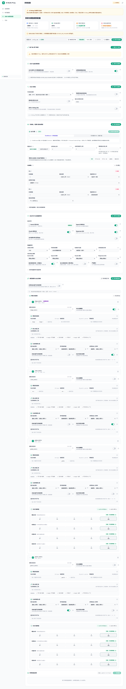
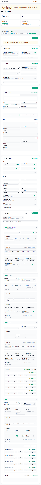
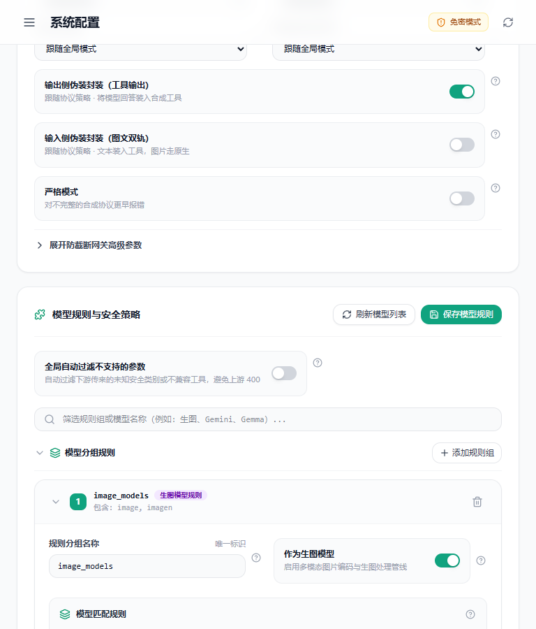
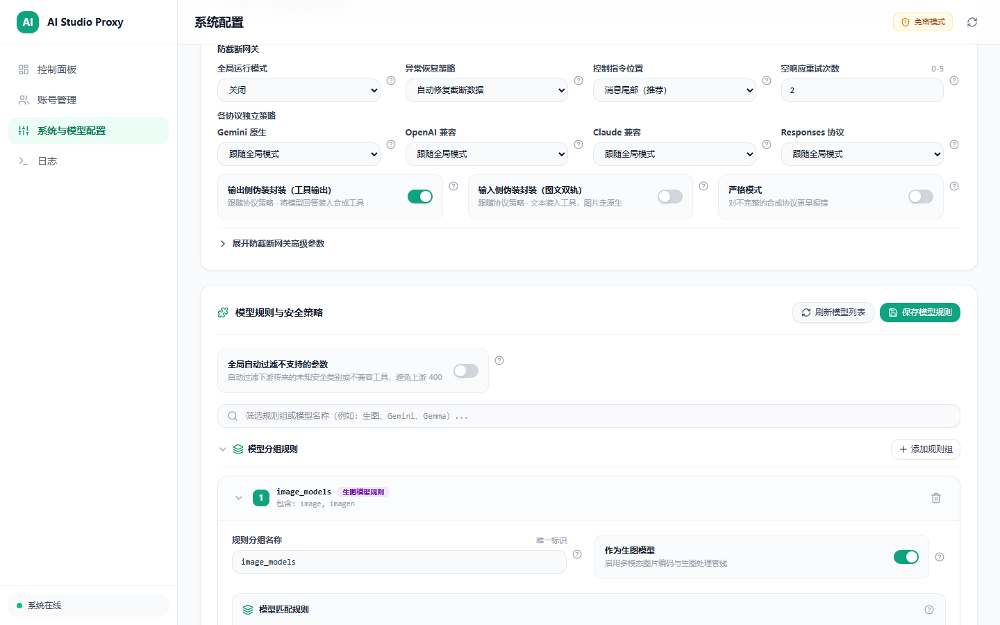

# REV-2.1.5.2 — 设置页「刷新模型列表」按钮 + 模型发现 P2 打包返工

- **审查角色**：100% 独立只读 Reviewer（与 Worker 零上下文共享，全部结论以亲眼核验为准）
- **审查对象**：主工作区未提交改动（`git diff`，基线 `8daaffd`）
- **审查环境**：Windows / pwsh 7 / Python 3.13 / Ruff 0.17.1；前端 Vite + Vue 3 + bun
- **审查时间**：2026-11-20
- **结论**：**PASS**（0 × P0 / 0 × P1 / 8 × P2 / 4 × Q / 7 × N；无破坏性、无风控安全回归、无测试弱化）

范围摘要：前端设置页新增「刷新模型列表」标题栏按钮、`refreshModels()` 与 `ModelsRefreshResponse` 类型、static 产物重建；后端 P2-2/P2-4/P2-5/P2-6/P2-7/P2-8 与 Q-④ 闭环；Worker 三处自主改动（`_ensure_fallback_cache`、`ui_sandbox.models_refresh_payload`、`routes_system` 鸭子类型）均经独立审计。本轮未发现需要返工的 P0/P1；8 项 P2 全部为可跟踪的文案一致性、超时预算口径、测试缺口与既有遗留，均附 `file:line` 与证据。UI 现状经本人三分辨率 Sandbox 实测与源码逐行核对，**未发现 Worker 编造 UI 事实**。

---

## 1. 审查范围与零触碰核验

`git diff --name-only 8daaffd`（共 12 个文件，与 Worker 声称集合完全一致）：

```
src/aistudio_api/api/app.py
src/aistudio_api/api/routes_system.py
src/aistudio_api/api/ui_sandbox.py
src/aistudio_api/infrastructure/gateway/model_discovery.py
src/aistudio_api/static/assets/SettingsView.js
src/aistudio_api/static/assets/index.js
tests/unit/test_model_discovery_browserless.py
tests/unit/test_model_warmup_refresh.py
tests/unit/test_routes_system.py
web/src/api/system.ts
web/src/types/system.ts
web/src/views/SettingsView.vue
```

- **零触碰红线全部通过**：`REV-*.md`、`web/src/components/settings/SchedulingCard.vue`、`web/src/components/ui/Button.vue`、`web/src/assets/main.css`、`defaults/**`、`docs/changelog.md`、`AGENT.md` 的 `git status` 均为空。
- **无调试残留**：对全部新增行做 `console.log|print(|breakpoint|pdb|TODO|FIXME|XXX|debugger` 扫描，0 命中。
- **`git diff --check 8daaffd`**：退出码 0，无空白错误。
- **无隐私/密钥**：diff 与新增沙盒 mock 全部为虚构模型与固定中文字符串，无 Cookie/token/密钥。

---

## 2. UI 现状独立核验（不信任 Worker 核验表）

### 2.1 卡片标题栏结构与按钮落点（源码）

`web/src/views/SettingsView.vue:620-655`：

```vue
<div class="flex flex-col sm:flex-row sm:items-center justify-between gap-3 border-b border-gray-100 pb-4">
  <div class="flex items-center gap-2.5">           <!-- 标题区：Puzzle 图标 + h3「模型规则与安全策略」 -->
  <div class="flex items-center gap-2 flex-wrap">   <!-- 动作区（新增容器） -->
    <Button variant="secondary" size="sm" :loading="refreshingModels"
            title="立即重新拉取上游模型目录并清除失败退避（最长约 30 秒）" @click="refreshModels">
      <RefreshCw v-if="!refreshingModels" class="w-3.5 h-3.5" />
      <span>{{ refreshingModels ? '刷新中...' : '刷新模型列表' }}</span>
    </Button>
    <Button variant="primary" size="sm" :loading="isSaving('model')" @click="saveSection('model')"> 保存模型规则 </Button>
  </div>
</div>
```

- 按钮**位于 primary「保存模型规则」左侧**，DOM 顺序经浏览器实测为 `["刷新模型列表", "保存模型规则"]`。
- 卡片整体位于 `<template v-if="activeMode === 'visual'">` 内（`SettingsView.vue:584` 起），YAML 模式整张卡片（含按钮）不渲染 —— 实测确认。

### 2.2 先例样式比对（独立核验，非 Worker 口述）

- **同页先例**：`SettingsView.vue:507-513` 动作区使用完全相同的 `flex items-center gap-2 flex-wrap` 容器，内含 `variant="secondary" size="sm"` + `BookOpen w-3.5 h-3.5` 的「参数规范字典」按钮。
- **loading 先例**：`SettingsView.vue:547-557`「重置默认」为 `variant="secondary" size="sm" :loading="resetting"` + `<RotateCcw v-if="!resetting">` + `{{ resetting ? '重置中...' : '重置默认' }}`，与本次新增按钮的模式**逐字同构**；`Button.vue:37-40` 的 loading 态自带 `Loader2 w-4 h-4 animate-spin`，因此 `v-if="!refreshingModels"` 隐藏 `RefreshCw` 后只会存在 1 个 spinner，不会双图标。
- **标题栏容器先例**：`ApiKeyManagerCard.vue:143`、`LogConfigCard.vue:54`、`ProtocolAtgCard.vue:117`、`SchedulingCard.vue:662`、`SecurityBrowserCard.vue:55` 全部使用同一套 `flex flex-col sm:flex-row sm:items-center justify-between gap-3 border-b border-gray-100 pb-4`。

结论：新增按钮的落点、variant/size、图标尺寸、loading 文案、容器类名均与项目既有先例一致，**无自创样式**。

### 2.3 交互状态机与三态文案（源码 + 实测双证）

`SettingsView.vue:263-291`：

| 状态 | 判定 | 文案（逐字） | 实测结果 |
|---|---|---|---|
| 成功 | `res.error` 空 且 `source ∈ {live_page, live_signer}` | `模型列表已刷新：来源 {中文映射}，共 {N} 个模型` | 触发 `toast.success`，实测 `模型列表已刷新：来源 实时接口，共 10 个模型` |
| 降级 | `res.error` 空 且其他来源 | `模型列表已更新，但未拿到实时数据：当前来源 {中文映射}，共 {N} 个模型` | 触发 `toast.warning`，实测 `模型列表已更新，但未拿到实时数据：当前来源 本地快照，共 10 个模型` |
| 失败 | `res.error` 非空 或 请求抛错 | `模型列表刷新失败：{error}` | 触发 `toast.error`（红色边框），实测 `模型列表刷新失败：sandbox scenario: 无可用账号候选` |

- **来源中文映射**（`SettingsView.vue:263-269`）：`live_page=真实页面`、`live_signer=实时接口`、`live_http=实时接口（直连兜底）`、`snapshot=本地快照`、`fallback=内置兜底`；未知来源回退原始字符串，无 `undefined` 风险。
- **无确认弹窗**：`refreshModels()` 内无 `confirm()`；实测点击后请求立即发出。
- **并发保护**：`refreshModels.value` 为真时直接 return（`:272`），且按钮 `disabled`（`Button.vue:17` 的 `disabled || loading`）。
- **loading 实测**：点击后 250ms 抓取 DOM 得到 `btnText="刷新中..."`, `disabled=true`, `svg.animate-spin=1`, `svg=1`（`RefreshCw` 已隐藏），符合设计。

### 2.4 API/类型契约一致性

- `web/src/api/system.ts:57-61`：`refreshModels(): Promise<ModelsRefreshResponse>` → `POST /api/models/refresh`，无 body。
- `web/src/types/system.ts:32-36`：`{ source: string; model_count: number; error?: string }`。
- 后端 `routes_system.py:399-405` 返回 `{source, model_count}`，仅当 `error` 为真时附加 `error`，**与前端可选字段完全对齐**；前端只消费 `source / model_count / error`，未使用响应中不存在的字段。
- 鉴权：路由挂 `protected_router`（`routes_system.py:356`），`app.py:651` 统一注入 `require_web_auth`；缺失密码时 `dependencies.py:199-212` 返回 **401**，前端 `request()` 自动跳转登录。

### 2.5 YAML 模式

实测切到「YAML 源码」后 `refreshButtonVisible=false`、`modelCardPresent=false`、页面仅剩 1 个 textarea，符合「YAML 模式不渲染按钮」的要求。

---

## 3. P2 逐项闭环核验

| 项 | 要求 | 实测证据 | 判定 |
|---|---|---|---|
| **P2-2** | signer 路细化 `live_signer` 并入 `LIVE_SOURCES`、`DISCOVERY_TRUTH_SOURCES` 同步、磁盘路保持 `live_http` | `model_discovery.py:648` `LIVE_SOURCES={live_page,live_signer,live_http}`；`:658-660` `DISCOVERY_TRUTH_SOURCES` 含 `live_signer`；`:965` `_accept_live(..., source="live_signer")`；磁盘路仍 `:992` `source="live_http"`；单测 `test_model_discovery_browserless.py:185` 改为 `live_signer`，`:234` 保持 `live_http` | ✅ |
| **P2-4** | `_fetch_via_signer` 加 30s `asyncio.wait_for`，超时按非 403 瞬态继续候选 | `model_discovery.py:49` 常量 30.0；`:1338-1349` `wait_for` + `TimeoutError` → `RuntimeError`；signer 循环 `:969-980` 对 `ListModelsHttpError`/`Exception` 分流，`RuntimeError` 落入通用 `Exception` 继续下一候选，`abort_round` 仅在 403 置位 | ✅（预算口径见 P2-2） |
| **P2-6** | `reset_backoff` keyword、**锁内**清退避、删除公开 `reset_backoff()`、零 Shim | `model_discovery.py:808` keyword-only 参数；`:846-849` 在 `async with self._lock` **内**清 `_failure_streak`/`_next_retry_at`；原方法已删除；全库 `grep reset_backoff` 仅剩参数、docstring、`routes_system.py:385` 传参与测试，**0 残留调用** | ✅ |
| **P2-7** | 零候选轮记失败退避 | `model_discovery.py:1024` 无条件 `self._record_failure()`（删除 `attempted_any` 守卫）；单测 `test_model_discovery_browserless.py:644-660` 断言首轮 `streak==1`、`next_retry_at` 非空，且第二轮命中「退避期」且 streak 不再增长 | ✅ |
| **P2-8** | docstring 失实修正 | `model_discovery.py:244` 改为 `"Browserless sessions have no Page; discovery uses their signer transport."`，与实现一致 | ✅ |
| **Q-④** | signer 成功进入每日长间隔 | `model_discovery.py:653` `LIVE_REFRESH_SOURCES={live_page,live_signer}`；`app.py:150-159` `if source in LIVE_REFRESH_SOURCES: live_refresh_interval_sec`；`test_model_warmup_refresh.py:22-30` 参数化验证 `live_page`/`live_signer` 均为 86400，`:33` 验证 `fallback/snapshot/live_http` 为 600 | ✅（文档滞后见 P2-7） |
| **P2-5** | 路由级 4 项 + 循环异常兜底单测 | `test_routes_system.py:217`（未鉴权 401）、`:229`（成功结构）、`:262`（超时 error）、`:292`（异常 error 非 500）；`test_model_warmup_refresh.py:187-213`（CancelledError 透传 + 告警 + 600s 续跑） | ✅ |

---

## 4. Worker 自主改动安全审计

### 4.1 `_ensure_fallback_cache`（`model_discovery.py:733-743`）

- 仅在 `not self._cached_models` 时物化内置表；已有缓存（snapshot/live/fallback）时**原样返回**，不改变正常缓存语义。
- 物化时同步 `set_paid_models(...)`、`_last_fetched_at=now`、`last_source="fallback"`，与 `__init__` 脏快照回退（`:759-771`）与第 4 步冷启动兜底（`:1027-1036`）完全同构。
- 两个调用点均在「闸门命中」分支（`:844`、`:858`），此前该分支返回可能为空的 `_cached_models`（调用方拿到空列表）；改动是显式修正，不是语义漂移。
- 唯一瑕疵：`:836-843` 的锁外闸门段在「缓存为空」这一异常态下会无锁写共享状态；写入幂等、内容等价，且该状态在生产中不可达（失败轮的第 4 步必定填充缓存）。记为 **N-1**，不阻塞。

### 4.2 `ui_sandbox.models_refresh_payload`（`ui_sandbox.py:1331-1348`）

- 方法挂在 `UISandbox` 实例上；`RuntimeState.ui_sandbox` 默认 `None`（`state.py:600`），仅在 `lifespan` 的 `if ui_debug:` 分支赋值（`app.py:377-388`），退出时清空（`:414-415`）。生产路径 `ui_debug=False` → 该方法**不可达**。
- 场景映射：`empty` → `{source:"fallback", error:...}`（错误 toast 可复现）；`narrow_edge` → `{source:"snapshot"}`（降级 toast）；其余 → `{source:"live_signer"}`（成功 toast）。三态均可在离线沙盒复现，实测通过。
- 双保险：即使该 mock 缺失，`model_discovery.get_models` 在 ui_debug 下也会 `_ui_debug_active()` 直接返回 `sandbox_model_catalog()`（`model_discovery.py:820-823`），不会触网。

### 4.3 `routes_system.py` 鸭子类型接 mock（`:368-376`）

- `getattr(runtime_state, "ui_debug", False)` 先短路，且 `RuntimeState` 恒有该字段（`state.py:599`），`getattr` 默认值仅服务于测试里的 `SimpleNamespace`。
- **同文件先例**：`routes_system.py:296-311`（`/api/engine/health-check`）早已用相同的 `getattr(sandbox, ..., None)` + `callable` + `dict` 归一模式，本次只是沿用既有约定，非新范式。
- 生产路径 `ui_debug=False` 时 `sandbox=None`，`callable(None)` 为 False，直接落到真实 `model_discovery` 调用，**100% 不受影响**。

### 4.4 `_model_warmup_loop` 抽取（`app.py:187-202`，调用点 `:636`）

- 与旧内联循环（基线 `app.py:615-624`）逐句等价：`CancelledError` 直接 `raise`；其他异常 `warning` 后 `sleep(_model_warmup_interval_seconds("fallback"))`；无「绕过退避强刷」——异常后续跑的是 `_model_warmup_cycle → get_models(force_refresh=True)`，而 `get_models` 的闸门检查（`:836`）仍然生效（`force_refresh` 不越过闸门，只有 `reset_backoff` 越过，且仅管理端点传 True）。
- 单测 `test_model_warmup_refresh.py:187-213` 用 `pytest.raises(asyncio.CancelledError)` 坐实透传，断言 `sleeps==[600]` 与告警文本。

---

## 5. 测试真实性

- 新增用例逐条阅读，断言均有牙齿：
  - `test_models_refresh_requires_web_auth`（`:217`）：`settings.web_password` 置真后无凭据请求必须 401；路由不存在只会 404，**401 证明路由挂载 + 鉴权生效**。
  - `test_models_refresh_returns_source_and_count`（`:229`）：断言 `source/model_count` 结构、无 `error`、且透传 `force_refresh=True`、`reset_backoff=True`。
  - `test_models_refresh_timeout_returns_error_field`（`:262`）：把路由预算压到 0.01s、让 `get_models` 挂 5s，断言 200 + `超时` + `model_count` 为 int（**不是 500**）。
  - `test_models_refresh_failure_returns_error_field_not_500`（`:292`）：`RuntimeError` 断言 200 + `RuntimeError: upstream exploded` 落进 `error`。
  - `test_reset_backoff_bypasses_gate_and_recounts_failed_round`（`:621`）：预置 `streak=4`、`retry=+3600s`，若 `reset_backoff` 被忽略会命中闸门 → 断言 `streak==1` 失败；同时断言跑完一轮后重新进入退避（`streak=1`、`retry_at` 非空）。
  - `test_no_candidate_round_records_failure_and_gates_next_round`（`:644`）：无候选首轮 `streak==1`，次轮 `退避期` 且 `streak` 不变；恢复 `attempted_any` 守卫会立即失败。
  - `test_signer_timeout_falls_through_to_next_candidate`（`:664`）：首个 sender 挂 60s 并断言「超时必须被取消」（若未被取消会抛该断言），第二个 sender 200；断言 `last_source="live_signer"`、`last_error is None`、告警文本存在。
  - `test_warmup_loop_survives_cycle_exception`（`:187`）：首轮抛 `RuntimeError`、次轮抛 `CancelledError`，断言调用 2 次、只 sleep 一次 600s、告警出现；吞掉 `CancelledError` 或漏掉告警都会失败。
- **既有断言改写审计（未弱化）**：`test_manual_refresh_endpoint_resets_backoff_and_forces_refresh` 删除了 `seen["streak"] / seen["next_retry_at"]` 断言，原因是路由不再直接改服务状态，改为透传 `reset_backoff=True`；对应的「真的清零」改由服务级 `test_reset_backoff_bypasses_gate_and_recounts_failed_round` 用真实 `ModelDiscoveryService` 断言。**覆盖合起来等价且更贴近真实实现**，不是为过测试而删除断言。
- 统计：全量 **1713 passed**（基线记忆 1704，净增 9 = 路由 4 + discovery 3 + 循环 1 + `live_sources` 参数化净增 1）；三个受影响模块 55 passed。

---

## 6. 门禁真实输出

| 门禁 | 命令 | 实测输出 | 判定 |
|---|---|---|---|
| 依赖同步 | `uv sync --extra dev` | `Resolved 47 packages / Audited 47 packages` | ✅ |
| Ruff Lint | `uv run ruff check .` | `All checks passed!` | ✅ 0 error |
| Ruff 格式 | `uv run ruff format --check .` | `62 files would be reformatted, 329 files already formatted` | ⚠️ **存量红**（见 P2-8）；本 diff 未新增 |
| Pyright | `uv run pyright src tests` | `0 errors, 0 warnings, 0 informations` | ✅ |
| 全量测试 | `$env:PYTHONUTF8='1'; uv run pytest -q` | `1713 passed in 45.13s` | ✅ |
| 前端 Lint | `cd web; bun run lint`（`--max-warnings 0`） | 退出码 0，无告警输出 | ✅ 0 error / 0 warning |
| 前端类型 | `cd web; bun run type-check`（`vue-tsc -b`） | 退出码 0 | ✅ |
| 前端构建 | `cd web; bun run build` | `✓ built in 2.82s` | ✅ |
| Diff 空白 | `git diff --check 8daaffd` | 无输出，退出码 0 | ✅ |

**关于「ruff format 63 存量文件」的说法**：实测为 **62** 个未格式化文件（4 个 `.md` + 58 个 `.py`），且全部为**存量**——本 diff 触碰的文件中只有 `ui_sandbox.py` 在名单内，我用 `git show 8daaffd:...ui_sandbox.py` 单独跑 `ruff format --check` 确认**基线同样未格式化**；其格式差异位于 `:220-224`、`:1441-1500` 等与本轮改动无关的区域。Worker 说的「存量」成立，数字差 1（63 vs 62）记为 **N-3**。

**构建产物一致性**：`bun run build` 后 `src/aistudio_api/static/assets/SettingsView.js` 与 `index.js` 相对基线的 numstat 仍为 `3/3`、`1/1`（与 Worker 产物一致），产物中可见 `刷新模型列表`、`live_signer`、`refreshModels`。Windows 构建同时把 `static/index.html` 重写为 CRLF（内容逐字节等价），我已用 `git checkout HEAD -- src/aistudio_api/static/index.html` 还原为 Worker 的 LF 版本，工作树未引入额外改动（见 N-4）。

---

## 7. UI 沙盒实测（AGENT.md §10.2 强制）

启动方式：`uv run python main.py server --port 18371 --ui-debug`（`background_process` 托管，另以 18372 复跑取全页截图），仅访问 `127.0.0.1`，结束后 `stop`，两端口 `Test-NetConnection` 均失败、无 python 进程残留。

### 7.1 三分辨率几何实测

| 视口 | 按钮尺寸 | 动作区尺寸 | 与「保存模型规则」同排 | 页面横向溢出 | 结论 |
|---|---|---|---|---|---|
| 1440×900 | 118×30，`x=1141` | 242×30（`flex-wrap`） | 是（前者在左） | `scrollWidth==clientWidth==1440` | ✅ |
| 1024×900 | 118×30，`x=725` | 242×30 | 是 | `1024==1024` | ✅ |
| 768×900 | 118×30，`x=477` | 242×30（容器内未换行） | 是；标题栏仍为 `row`（`sm:` 640px 断点以上） | `768==768`，`right=595 < 768` | ✅ |

1440 实测计算样式：`background-color: rgb(255,255,255)`、`border: 1px solid …`、`padding: 6px 12px`、`font-size: 12px`、`gap: 6px` → 证实为 `variant=secondary / size=sm`；`title="立即重新拉取上游模型目录并清除失败退避（最长约 30 秒）"`；`svg` 数量 1（`RefreshCw`）。

### 7.2 状态与文案实测

- **loading**：临时在页面内把 `/api/models/refresh` 的 fetch 延迟 6s，点击后 250ms 读取 DOM：`刷新中...` / `disabled=true` / `svg.animate-spin=1` / 总 `svg=1`（无双图标）。
- **成功**：默认场景 `source=live_signer` → `模型列表已刷新：来源 实时接口，共 10 个模型`（success toast）。
- **降级**：`POST /api/debug/ui-scenario {"scenario":"narrow_edge"}` → `模型列表已更新，但未拿到实时数据：当前来源 本地快照，共 10 个模型`（warning toast）。
- **失败**：`{"scenario":"empty"}` → `模型列表刷新失败：sandbox scenario: 无可用账号候选`，toast class 为 `border-red-200 text-red-800`（error）。
- **控制台**：`playwright_browser_console_messages(level=error)` → `Total messages: 0 (Errors: 0, Warnings: 0)`。

### 7.3 截图归档（本人实测，未被 Worker 影响）

完整页面（全页，主证据）：




补充视口证据（卡片定位与三态）：






> 说明：Worker 已归档的 `ui-refresh-models-1440x900.png` 实际是 `1440×7852` 全页图，`ui-refresh-models-375x900.png` 实际是 `375×13125`，命名与真实尺寸不符（内容真实，非编造），记 **N-2**。

---

## 8. 遗留项登记

本轮之后仍未关闭的 P2/Q（逐项已确认仍存在于代码）：

| 编号 | 遗留项 | 代码现状（file:line） | 状态 |
|---|---|---|---|
| 旧 P2-1 → 本报告 P2-5 | discovery 与在途生成共用 signer worker，busy 槽位不排除 | `instance_manager.py:791-805` 仅做排序偏好，仍返回 busy 槽；`model_discovery.py:958-980` 不占 `active_requests` | 仍在 |
| 旧 P2-3 → 本报告 P2-6 | 磁盘兜底旧指纹 + 伪造 visit-id | `model_discovery.py:1394-1409`（`X-AIStudio-Visit-Id: v1_<uuid4>`、静态 `EXT_BIN`、裸 `httpx.AsyncClient`） | 仍在，待 VPS 确诊 |
| Q-① | 退避不持久化 | `_next_retry_at` 仅内存（`:1101`），`_save_snapshot` 只写 `version/fetched_at/models`（`:787-800`） | 仍在 |
| Q-② | 闸门连带挡 browser `live_page` | 闸门位于候选选择之前（`:836-844`），对全部来源一视同仁 | 仍在 |
| Q-③ | signer 并发语义未审计 | `waa-signer/cmd/waa-signer/main.go:1263-1387` 不在本仓审查范围 | 仍在 |

**偏离 6（长间隔注释）核验为真**：`model_defaults.py:2102-2104` 仍写「`live_refresh_interval_sec` 只用于 `last_source == "live_page"`…其他来源（fallback/snapshot/live_http）」，与 Q-④ 后的实现不符。作为对照，另有三处**同类滞后文案**因本轮零触碰红线不可修改，登记待后续步骤：`defaults/config.schema.json:353`、`defaults/config.yaml:148-149`、`web/src/components/settings/SchedulingCard.vue:1493`（「真实页面发现成功后的刷新间隔」）。

---

## 9. P0 / P1 / P2 / Q / N 清单

### P0（破坏性 / 风控安全，必须返工）
无。

### P1（提交前应修）
无。

### P2（可跟踪改进）

- **P2-1（新增）** `SettingsView.vue:278-284` 与 `model_discovery.py:648` 口径不一致：`live_http` 属于后端 `LIVE_SOURCES`（真实 live 成功、写入快照），但前端成功分支只认 `live_page/live_signer`，会落入「**未拿到实时数据**」的 warning；而 `MODEL_SOURCE_LABELS` 又把 `live_http` 标注为「实时接口（直连兜底）」，同一条 toast 自相矛盾。建议把 `live_http` 纳入成功分支（成功文案本身已能表达「直连兜底」来源），或改写降级文案。无数据/功能影响，属文案准确性。
- **P2-2（新增）** `model_discovery.py:49` 的 signer 单次超时 `30.0s` 与 `routes_system.py:48` 的整轮预算 `30.0s` **等值**；`:45-48` 注释声称该超时「不占用整段预算、可回落到下一候选」，但在管理端点上首个卡死候选就会吃满 30s 预算，健康候选来不及尝试（预热循环无外层预算，行为符合注释）。建议单次超时降到 10s 或按候选数分配预算，并同步注释。
- **P2-3（新增）** 两处新增分支零单测：`model_discovery.py:733-743` 的 `_ensure_fallback_cache` **物化分支**（缓存为空 + 闸门命中）无用例（现有用例只覆盖「缓存非空原样返回」）；`ui_sandbox.py:1331-1348` 的 `models_refresh_payload` 与其路由分支 `routes_system.py:367-376` 无用例。风险低（均只在异常态/沙盒态可达），建议补 1-2 个用例防回归。
- **P2-4（新增，风控加固）** 手动刷新端点无服务端最小间隔：`routes_system.py:357-405` 每次调用都 `reset_backoff=True` 强制整轮 fan-out（signer 各会话 + 磁盘候选），按钮把「强制清退避」变成一键操作（`SettingsView.vue:272` 仅做前端防抖）。在 Google 风控敏感场景下，运维连点会把已累积的 24h 退避反复打回 600s。建议增加服务端短冷却（如 60s 内重复调用直接返回上次结果/`retry_in`）。
- **P2-5（遗留 P2-1）** discovery 与在途生成共享 signer worker，busy 槽位不排除：`instance_manager.py:791-805`、`model_discovery.py:958-980`。建议 `active_requests == 0` 过滤或全 busy 时跳过本轮。
- **P2-6（遗留 P2-3）** 磁盘 `auth.json` 兜底仍是裸 `httpx` + 伪造 visit-id + 静态 ext-bin：`model_discovery.py:1394-1409`，待 VPS 实测 403 根因确诊。
- **P2-7（口径滞后）** `model_defaults.py:2102-2104` docstring 未随 Q-④ 更新（可改未改）；`defaults/config.schema.json:353`、`defaults/config.yaml:148-149`、`SchedulingCard.vue:1493` 同类文案受本轮零触碰约束，需后续单独步骤统一为「live_page / live_signer 成功用长间隔」。
- **P2-8（存量）** 全仓 `uv run ruff format --check .` 红：62 个文件（含此前即未格式化的 `ui_sandbox.py`），本 diff 未新增；建议单开一个纯格式化提交收口，避免与功能改动混杂。

### Q（疑问）

- **Q-1** 退避状态不持久化（`model_discovery.py:1101`、`:787-800`）：崩溃重启会清空退避，是否需要在快照里持久化 `failure_streak/next_retry_at`？
- **Q-2** 退避闸门对全部来源生效（`:836-844`），会连带挡住 browser 引擎的 `live_page` 发现；混合引擎部署是否接受该耦合？
- **Q-3** signer 单 worker 对「ListModels 与 GenerateContent 并发」的语义（排队/拒绝/复用）未审计（`waa-signer/.../main.go:1263-1387`），P2-5 严重度取决于此。
- **Q-4** `live_http`（磁盘直连成功）在产品口径上算「实时成功」还是「降级兜底」？直接决定 P2-1 的修法；建议与 Q-④ 的 `LIVE_REFRESH_SOURCES` 口径一并确认。

### N（备注）

- **N-1** `_ensure_fallback_cache` 的锁外闸门段在「缓存为空」异常态下无锁写共享状态，写入幂等且生产不可达（失败轮第 4 步必填充缓存），不影响正确性。
- **N-2** Worker 截图命名与实际尺寸不符（`ui-refresh-models-1440x900.png` 实为 1440×7852；`375x900` 实为 375×13125），内容真实非编造。
- **N-3** Worker 称「ruff format 63 存量文件」，实测 62（4 md + 58 py），差异可能来自统计时刻；「存量」判断成立。
- **N-4** Windows `bun run build` 会把 `static/index.html` 写成 CRLF（内容等价）；我已还原为基线 LF 版本，工作树无额外改动。
- **N-5** `test_warmup_loop_survives_cycle_exception` 的 `sleeps == [600]` 依赖运行期 `config.yaml` 的 `fallback_refresh_interval_sec`（本机默认 600 通过）；若某环境自定义该值会误红，建议注入 `settings` 或 mock 配置读取。
- **N-6** `routes_system.py:367-376` 的鸭子类型接 mock 与同文件 `:299-313`（engine health）既有先例一致，且 `ui_debug=False` 短路，生产路径安全。
- **N-7** 旧断言改写经逐条比对为「职责迁移」而非弱化：路由不再直接改服务状态，服务级用例以真实 `ModelDiscoveryService` 断言清零与重计退避，覆盖等价且更真实。

---

## 10. 只读声明

本次审查为 100% 只读。除本报告 `docs/dev/rebuild/domains/P5-generation/reviews/REV-2.1.5.2-models-refresh-button.md` 与该目录 `assets/` 下 `rev-2.1.5.2-*.png` 截图外，未修改任何源码、测试、配置或文档。

- 实跑 `bun run build` 会重写 `src/aistudio_api/static/`；其中 `SettingsView.js` 与 `index.js` 产物与 Worker 版本一致（numstat 不变），`index.html` 因 Windows 换行被重写为 CRLF，已用 `git checkout HEAD -- src/aistudio_api/static/index.html` 还原，最终 `git diff` 与审查开始时一致。
- 实机服务仅以 `--ui-debug` 沙盒启动（端口 18371/18372），仅访问 `127.0.0.1`；结束时均已 `stop`，端口 `Test-NetConnection` 失败、无进程残留，未访问真实 Google / 真实账号 / 外网。
- 报告未预先填入任何证据：上述门禁输出、测试统计、几何尺寸与 toast 文案均为本轮实跑/实采结果。

---

## 二轮复审（返工核验）

- **复审角色**：100% 独立只读 Reviewer（与 Worker 零上下文共享，全部结论以本轮亲眼核验为准）
- **复审对象**：基线 `0e65b32` 之后的未提交返工 diff；其中暂存区 11 张截图 `git rm` 属主控有意的截图裁剪，不计入 Worker 代码改动
- **复审环境**：Windows / pwsh 7 / Python 3.13 / Ruff 0.17.1；Vite + Vue 3 + bun（`PYTHONUTF8=1`、`PYTHONIOENCODING=utf-8`）
- **复审时间**：2026-11-20
- **结论**：**PASS**（0 × P0 / 0 × P1 / 0 × 新增可裁决 P2；新 P2-1/P2-2/P2-3/P2-4 与 Q-4 全部闭环；旧 P2-5/P2-6、Q-1/Q-2/Q-3、ruff format 存量均属明确延后或依赖外部）

### 1. 改动集合与全量 diff 审计

复审开始时 `git status --short` 共 23 条 = **12 个修改文件**（`git diff --stat`：190 insertions / 20 deletions）+ **11 个已暂存删除的 PNG**；追加本章后为 24 条，多出的即本报告文件本身。`git diff --numstat` 实测逐文件如下，与 Worker 声称集合逐一对应，无多余文件：

```
1	1	defaults/config.schema.json
2	2	defaults/config.yaml
21	1	src/aistudio_api/api/routes_system.py
3	3	src/aistudio_api/infrastructure/gateway/model_defaults.py
6	3	src/aistudio_api/infrastructure/gateway/model_discovery.py
3	3	src/aistudio_api/static/assets/SettingsView.js
17	0	tests/unit/test_model_discovery_live_wiring.py
101	0	tests/unit/test_routes_system.py
26	1	tests/unit/test_ui_sandbox_stats_consistency.py
4	4	web/src/components/config/schema.ts
1	1	web/src/components/settings/SchedulingCard.vue
5	1	web/src/views/SettingsView.vue
```

- **零 `docs/**` 被 Worker 触碰**：`git status` 中 docs 下仅有 11 条 `D`（截图裁剪），Worker 未改动任何 `REV-*.md`/文档内容（docs 下唯一的 `M` 即本报告的二轮追加）；`git ls-files --others` 为空，无未跟踪残留。
- **无调试残留**：对全部新增行扫描 `console.log|print(|breakpoint|pdb|debugger|TODO|FIXME|XXX`，0 命中。
- **`git diff --check`**：还原 `index.html` 后退出码 0，无空白错误。

### 2. 「零契约变更」逐字核验（5 处口径同步）

| 文件 | diff 实际内容 | 键名/类型/默认值/逻辑 |
|---|---|---|
| `defaults/config.yaml:147-148` | 仅 2 行注释改写为「真实页面（live_page）与 signer 通道（live_signer）」 | 键 `live_refresh_interval_sec: 86400`、`fallback_refresh_interval_sec: 600`（`:150-151`）不变 ✅ |
| `defaults/config.schema.json:352` | 仅 `description` 字符串改写 | `live_refresh_interval_sec`/`fallback_refresh_interval_sec` 的 `type`/`minimum` 等约束（`:354-361`）不变 ✅ |
| `model_defaults.py:2102-2104` | 仅 docstring 两处措辞（并入 `live_signer`） | 函数签名与实现 0 变化 ✅ |
| `web/src/components/config/schema.ts:1012,1015,1016,1027` | 仅 `title`/`description`/`explanation` 文本 | `defaultValue: 86400`/`recommendedValue: 86400`（`:1017-1018`）、`defaultValue: 600`（`:1028`）、`type: 'number'` 与 `key` 全部不变 ✅ |
| `web/src/components/settings/SchedulingCard.vue:1494` | 仅 `label` 文案 | `ConfigInput` 的 `:model-value`/`updateFeature(...)` 与 `Math.max(1, ...)` 逻辑不变 ✅ |

结论：「零契约变更」声明**成立**，五处均为纯注释/描述/文案。

### 3. 四项 P 修复正确性

| 项 | 核验证据 | 判定 |
|---|---|---|
| **P2-1** | `SettingsView.vue:279-283` 成功分支为 `live_page \|\| live_signer \|\| live_http`，与后端真值集合 `LIVE_SOURCES = {live_page, live_signer, live_http}`（`model_discovery.py:649`）**逐元素一致**；降级分支只剩 snapshot/fallback；`MODEL_SOURCE_LABELS` 的 `live_http: '实时接口（直连兜底）'`（`:266`）保持不变，成功 toast 因此语义自洽 | ✅ 闭环，Q-4 随之关闭 |
| **P2-2** | `model_discovery.py:50` `_SIGNER_FETCH_TIMEOUT_SECONDS = 20.0`（< 端点预算）；`routes_system.py:48` 整轮预算仍为 30.0；`:47-50` 与 `:1338-1339` 注释改为如实描述「单候选 20s / 整轮 30s / 首个分类 403 提前终止」。实测 20/30 配比给单候选留出 10s 端点余量，注释未夸大为「必然小于 30s」（见 N-2.2） | ✅ 闭环 |
| **P2-4** | `routes_system.py:49-50` 新增 `_MODEL_REFRESH_MIN_INTERVAL_SECONDS = 60.0` 与模块级 `_last_manual_refresh_started_at`；`:389-399` 在 `get_models` 之前（即 discovery 锁外）先判，`elapsed < 60` 时直接 `return` 且**不调用 `get_models`**；仅允许路径在 `:399` 写时间戳，`:405` 才传 `reset_backoff=True`。`math.ceil` 保证 `remaining >= 1`，不会出现「请 0 秒后再试」；沙盒分支在 `:375-384` 提前返回，不消耗该窗口 | ✅ 闭环 |
| **P2-3** | 4 个新增用例：`test_model_discovery_live_wiring.py:252-266`（空缓存 + 未来闸门 → 物化内置表并全量打 `fallback` 标记）、`test_ui_sandbox_stats_consistency.py:84-107`（三场景 payload）、`test_routes_system.py:370-413`（二次请求只调 1 次 `get_models`，`_next_retry_at == retry_at` 原值不变，文案含「手动刷新过于频繁/秒后再试」）、`:416-460`（`ui_debug=True` 只走沙盒且 `get_models.await_count == 0`；`ui_debug=False` 走真实路径且沙盒调用计数不增） | ✅ 闭环（1713 → 1717，+4 与用例数一致） |

### 4. 旧口径残留独立检索

在 `web/src`、`defaults/`、`src/` 全域自行检索 `真实页面发现|最高可信|live_page 成功|只用于.*live_page`：仅命中 `model_defaults.py:2102` 的**新**措辞（「只用于真实页面（live_page）与 signer 通道」），旧口径 **0 残留**；`web/src` 下再无「真实页面发现成功后的刷新间隔」「最高可信来源」字样。Worker「0 残留」声明成立。

### 5. 截图裁剪核验

- `git diff --cached --name-status` = **11 条 `D`**，全部位于 `docs/dev/rebuild/domains/P5-generation/reviews/assets/`，与主控声称的 11 张一致；无其他暂存改动。
- 磁盘保留 **恰为 2 张** 2.1.5.2 代表图：`rev-2.1.5.2-fullpage-1440.png`（实测 **1440×7852**，真实全页）与 `rev-2.1.5.2-success-toast-1440x900.png`（**1440×900**）。
- 目检：全页图确为设置页完整页面；特写图在「模型规则与安全策略」标题栏内清晰可读「**刷新模型列表**」按钮（左）与「保存模型规则」（右）。**但**该特写图画面内不含 toast 气泡本体（右上角为此前已淡出的空白区域），文件名「success-toast」与内容略有出入，记 **N-2.1**；不阻塞，本步骤按要求不新增截图，成功三态行为已由一轮 §7.2 实测文案与本轮三态单测共同兜底。

### 6. 门禁真实输出（本轮独立实跑）

| 门禁 | 命令 | 实测输出 | 判定 |
|---|---|---|---|
| 依赖同步 | `uv sync --extra dev` | `Resolved 47 packages` / `Audited 47 packages`，exit 0 | ✅ |
| Ruff Lint | `uv run ruff check .` | `All checks passed!`，exit 0 | ✅ 0 error |
| Ruff 格式 | `uv run ruff format --check .` | `62 files would be reformatted, 330 files already formatted` | ⚠️ 存量红；本轮 6 个 Python 改动文件单独检查为 `6 files already formatted` |
| Pyright | `uv run pyright src tests` | `0 errors, 0 warnings, 0 informations` | ✅ |
| 全量测试 | `$env:PYTHONUTF8='1'; uv run pytest -q` | `1717 passed in 46.12s`，exit 0 | ✅ 与声称一致 |
| 定向测试 | 6 个受影响模块中的 3 个测试文件 | `43 passed in 4.67s` | ✅ |
| 前端 Lint | `cd web; bun run lint`（`eslint src --max-warnings 0`） | exit 0，无告警输出 | ✅ |
| 前端类型 | `cd web; bun run type-check`（`vue-tsc -b`） | exit 0 | ✅ |
| 前端构建 | `cd web; bun run build` | `✓ built in 2.71s`，exit 0 | ✅ |
| Diff 空白 | `git diff --check` | 无输出，exit 0（还原 `index.html` 后） | ✅ |

- **构建产物一致性**：`SettingsView.js` 构建前后 SHA-256 均为 `9B6902ED…CF309E`，且产物内含 `Pe={live_page:"真实页面",live_signer:"实时接口",live_http:"实时接口（直连兜底）",…}` 与 `V.source==="live_page"||V.source==="live_signer"||V.source==="live_http"`，与源码一致。
- **N-4 复现**：Windows `bun run build` 再次把 `static/index.html` 重写为 CRLF，已用 `git checkout HEAD -- src/aistudio_api/static/index.html` 还原；最终 `git status` 中 static 仅剩 `SettingsView.js`（3/3），与审查开始时一致。

### 7. 台账二轮状态

| 项 | 二轮状态 | 依据 |
|---|---|---|
| 新 P2-1 | ✅ 已闭环 | `SettingsView.vue:279-283` ↔ `model_discovery.py:649` |
| 新 P2-2 | ✅ 已闭环（见 N-2.2） | `model_discovery.py:50`、`routes_system.py:48`、`:1338-1339` |
| 新 P2-3 | ✅ 已闭环 | 4 个新用例，1717 passed |
| 新 P2-4 | ✅ 已闭环（见 N-2.4/N-2.5） | `routes_system.py:389-405` |
| Q-4 | ✅ 已闭环 | `live_http` 纳入成功分支；按钮标签保持「实时接口（直连兜底）」 |
| P2-7（口径滞后） | ✅ 已闭环 | 5 处文案同步，零契约变更 |
| 旧 P2-5（signer 并发争用） | ⏸ 明确延后 | `instance_manager.py:800-804` 仍只做空闲优先排序，未排除 busy；依存于 Q-3 的 signer 并发语义，本轮不扩范围 |
| 旧 P2-6（磁盘兜底旧指纹） | ⏸ 依赖外部 | `model_discovery.py:1398`（伪造 visit-id）、`:1412`（裸 `httpx.AsyncClient`）仍在，待 VPS 实测 403 根因确诊 |
| Q-1（退避不持久化） | ⏸ 明确延后 | `_next_retry_at` 仍仅内存（`:723`、`:1102`），快照仍只写 models |
| Q-2（闸门连带挡 live_page） | ⏸ 设计取舍待定 | 闸门仍在候选选择之前（`:837-845`） |
| Q-3（signer 并发语义） | ⏸ 依赖外部 | `waa-signer/.../main.go` 不在本仓本轮审查范围 |
| P2-8（ruff format 存量） | ⏸ 明确延后 | 仍为 62 个文件，本 diff 未新增 |

**重点判定：本轮之后不存在「可自行裁决却未修」的 P2。** 20s/30s 配比、60s 节流阈值、`math.ceil` 取整均为已落地的明确裁决；剩余项均受外部条件或既有架构约束，不属本轮可自裁范围。

### 8. 新增备注

- **N-2.1** 保留的 `rev-2.1.5.2-success-toast-1440x900.png` 实为「按钮 + 设置卡片」特写，画面内无 toast 气泡（存在命名与内容的小出入，非编造）；按钮清晰可见，满足代表性证据要求，不阻塞。
- **N-2.2** 20s 单候选 / 30s 整轮：若同时存在 ≥2 个卡死候选，整轮仍可能触达端点 30s 超时并返回明确 error；注释已如实写「usually」，未夸大为必然收敛，作为已知边界登记。
- **N-2.3** Windows `bun run build` 的 `index.html` CRLF 重写为平台现象，本轮已复现并还原，最终 diff 不含该文件。
- **N-2.4** 节流时间戳为进程级全局，且在「允许」路径的请求开始时即写入：失败/超时同样消耗 60s 窗口（符合防连点本意）；`ui_debug` 沙盒路径不写时间戳。
- **N-2.5** `remaining = math.ceil(60 - elapsed)` 在拒绝分支恒 ≥ 1，杜绝「请 0 秒后再试」的边界文案。

### 9. 二轮只读声明

本次二轮复审为 100% 只读。除在本文末追加本「二轮复审（返工核验）」章节外，未修改任何源码、测试、配置、文档或截图；未新增/删除任何截图。实跑 `bun run build` 会重写 `src/aistudio_api/static/`，其中 `SettingsView.js` 产物与 Worker 版本字节一致（SHA-256 前后相同），`index.html` 因 Windows CRLF 被重写后已用 `git checkout HEAD --` 还原；最终工作树与复审开始时一致。未启动任何服务、未发起任何真实网络请求、未使用真实 Cookie。
